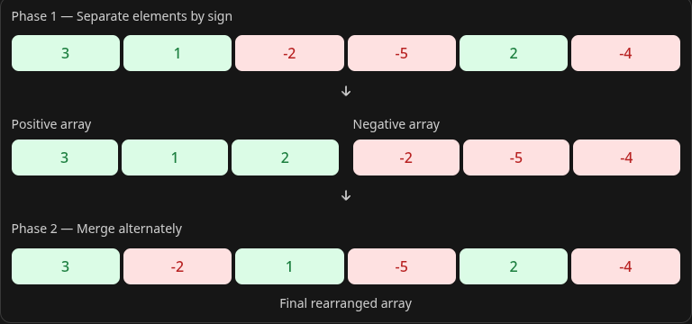
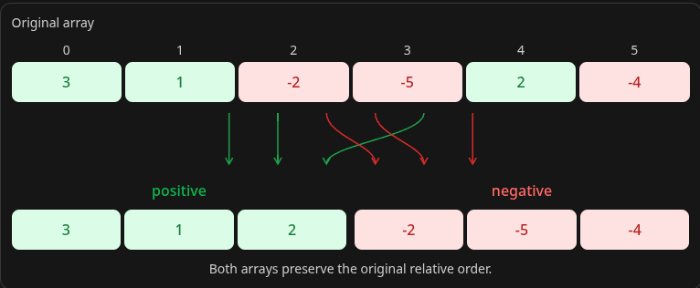
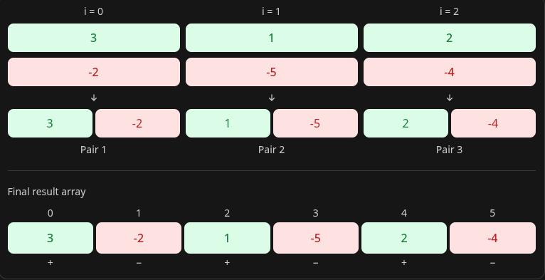

# Approach 1: Separate and Merge (Two Passes)

## Intuition

The problem requires us to rearrange the given array such that:

- Every pair of consecutive elements has opposite signs.
- The relative order of elements having the same sign is preserved.
- The resulting array always starts with a positive integer.
- The number of positive and negative integers is equal.

The simplest approach is to separate the positive and negative integers into two different arrays and then merge them alternately.

Consider the following example:

```text
nums = [3, 1, -2, -5, 2, -4]
```

After separating the elements according to their signs:

```text
positive = [3, 1, 2]
negative = [-2, -5, -4]
```

Since we traverse the original array from left to right, both arrays preserve the original relative order of their respective elements.

Now, we can construct the resulting array by selecting one element from `positive` followed by one element from `negative`.



---

## Approach

### Step 1: Initialize Two Temporary Arrays

```javascript
const positive = [];
const negative = [];
```

- `positive` stores all positive integers.
- `negative` stores all negative integers.

These arrays group elements by sign while maintaining their original order.

### Step 2: Traverse the Original Array

```javascript
for (const num of nums) {
    if (num > 0) {
        positive.push(num);
    } else {
        negative.push(num);
    }
}
```

For every element in `nums`:

- If `num > 0`, append it to `positive`.
- Otherwise, append it to `negative`.

Because `push()` inserts elements at the end of an array, the relative order of elements with the same sign remains unchanged. Since the problem guarantees there are no zeros, every element belongs to exactly one of these two arrays.

### Step 3: Initialize the Result Array

```javascript
const result = [];
```

Create an empty array to store the final rearranged elements.

### Step 4: Merge Both Arrays Alternately

```javascript
for (let i = 0; i < positive.length; i++) {
    result.push(positive[i]);
    result.push(negative[i]);
}
```

Since the problem guarantees an equal number of positive and negative integers, both temporary arrays have the same length (`n / 2`).

During every iteration:

1. Insert `positive[i]` into `result`.
2. Insert `negative[i]` immediately after it.
3. Advance to the next index.

Inserting the positive element first ensures that the resulting array always starts with a positive integer.

### Step 5: Return the Result

```javascript
return result;
```

---

## **Dry Run**

### **Input**

```
nums = [3, 1, -2, -5, 2, -4]
```

```
Index:    0    1    2    3    4    5
nums:    [3,   1,  -2,  -5,   2,  -4]
Sign:     +    +    -    -    +    -
```

**Total elements:** `n = 6`

**Positive elements:** `n / 2 = 3`

**Negative elements:** `n / 2 = 3`

The algorithm works in two phases:

- **Phase 1:** Separate positive and negative elements into two temporary arrays.
- **Phase 2:** Merge both arrays by inserting positive and negative elements alternately.

### **Phase 1: Separate Positive and Negative Elements**

#### **Initial State**

Create two empty arrays to store positive and negative integers separately.

```
const positive = [];
const negative = [];
```

```
Index:      0    1    2    3    4    5
nums:      [3,   1,  -2,  -5,   2,  -4]
            ↑
          Start

positive = []
negative = []
```

The first loop traverses the original array from left to right.

```
for (const num of nums) {
    if (num > 0) {
        positive.push(num);
    } else {
        negative.push(num);
    }
}
```

#### **Iteration 1:&#x20;**`num = 3`

**Current position:**

```
Index:    0    1    2    3    4    5
nums:    [3,   1,  -2,  -5,   2,  -4]
          ↑
        num = 3
```

**Before execution:**

```
positive = []
negative = []
```

**Check the condition:**

```
num > 0
3 > 0  // true
```

Since `3` is positive, execute the `if` block.

```
positive.push(3);
```

**After execution:**

```
positive = [3]
negative = []
```

Move to the next element.

#### **Iteration 2:&#x20;**`num = 1`

**Current position:**

```
Index:    0    1    2    3    4    5
nums:    [3,   1,  -2,  -5,   2,  -4]
               ↑
             num = 1
```

**Before execution:**

```
positive = [3]
negative = []
```

**Check the condition:**

```
num > 0
1 > 0  // true
```

Since `1` is positive, append it to the positive array.

```
positive.push(1);
```

**After execution:**

```
positive = [3, 1]
negative = []
```

Notice that `1` is inserted after `3`. Therefore, their original relative order is preserved.

#### **Iteration 3:&#x20;**`num = -2`

**Current position:**

```
Index:    0    1    2    3    4    5
nums:    [3,   1,  -2,  -5,   2,  -4]
                    ↑
                  num = -2
```

**Before execution:**

```
positive = [3, 1]
negative = []
```

**Check the condition:**

```
num > 0
-2 > 0  // false
```

Since the condition is false, execute the `else` block.

```
negative.push(-2);
```

**After execution:**

```
positive = [3, 1]
negative = [-2]
```

Move to the next element.

#### **Iteration 4:&#x20;**`num = -5`

**Current position:**

```
Index:    0    1    2    3    4    5
nums:    [3,   1,  -2,  -5,   2,  -4]
                         ↑
                       num = -5
```

**Before execution:**

```
positive = [3, 1]
negative = [-2]
```

**Check the condition:**

```
num > 0
-5 > 0  // false
```

Since `-5` is negative, append it to the negative array.

```
negative.push(-5);
```

**After execution:**

```
positive = [3, 1]
negative = [-2, -5]
```

The element `-5` is inserted after `-2`, preserving their original relative order.

#### **Iteration 5:&#x20;**`num = 2`

**Current position:**

```
Index:    0    1    2    3    4    5
nums:    [3,   1,  -2,  -5,   2,  -4]
                              ↑
                            num = 2
```

**Before execution:**

```
positive = [3, 1]
negative = [-2, -5]
```

**Check the condition:**

```
num > 0
2 > 0  // true
```

Since `2` is positive, append it to the positive array.

```
positive.push(2);
```

**After execution:**

```
positive = [3, 1, 2]
negative = [-2, -5]
```

Move to the last element.

#### **Iteration 6:&#x20;**`num = -4`

**Current position:**

```
Index:    0    1    2    3    4    5
nums:    [3,   1,  -2,  -5,   2,  -4]
                                   ↑
                                 num = -4
```

**Before execution:**

```
positive = [3, 1, 2]
negative = [-2, -5]
```

**Check the condition:**

```
num > 0
-4 > 0  // false
```

Since `-4` is negative, append it to the negative array.

```
negative.push(-4);
```

**After execution:**

```
positive = [3, 1, 2]
negative = [-2, -5, -4]
```

#### **Loop Termination**

All six elements of `nums` have been processed. Therefore, the first `for...of` loop terminates.

#### **Complete Dry Run Table — Phase 1**

| Iteration | Index | `num` | `num > 0` | Operation           | `positive`  | `negative`     |
| --------- | ----- | ----- | --------- | ------------------- | ----------- | -------------- |
| Initial   | —     | —     | —         | Initialize          | `[]`        | `[]`           |
| 1         | 0     | 3     | True      | `positive.push(3)`  | `[3]`       | `[]`           |
| 2         | 1     | 1     | True      | `positive.push(1)`  | `[3, 1]`    | `[]`           |
| 3         | 2     | -2    | False     | `negative.push(-2)` | `[3, 1]`    | `[-2]`         |
| 4         | 3     | -5    | False     | `negative.push(-5)` | `[3, 1]`    | `[-2, -5]`     |
| 5         | 4     | 2     | True      | `positive.push(2)`  | `[3, 1, 2]` | `[-2, -5]`     |
| 6         | 5     | -4    | False     | `negative.push(-4)` | `[3, 1, 2]` | `[-2, -5, -4]` |

#### **Final State After Phase 1**

```
Original Array:
[3, 1, -2, -5, 2, -4]
          |
          | Separate by sign
          |
    +-----+------+
    |            |
    v            v

Positive       Negative
[3, 1, 2]      [-2, -5, -4]
```





Both arrays preserve the original relative order.

```
positive.length = 3
negative.length = 3
```

Both temporary arrays contain an equal number of elements. We can now merge them alternately.

### **Phase 2: Merge Positive and Negative Elements**

#### **Initial State**

Create an empty array to store the final rearranged elements.

```
const result = [];
```

The second loop accesses both temporary arrays using the same index `i`.

```
for (let i = 0; i < positive.length; i++) {
    result.push(positive[i]);
    result.push(negative[i]);
}
```

Initially:

```
Index:       0    1    2

positive:   [3,   1,   2]
negative:   [-2, -5,  -4]

result = []

i = 0
positive.length = 3
```

During every iteration, we perform two insertions: first a positive element, then a negative element.

#### **Iteration 1:&#x20;**`i = 0`

**Before execution:**

```
Index:       0    1    2

positive:   [3,   1,   2]
             ↑
negative:   [-2, -5,  -4]
             ↑

result = []
i = 0
```

**Step 1: Check the loop condition**

```
i < positive.length
0 < 3  // true
```

Since the condition is true, the loop body executes.

**Step 2: Access the current elements**

```
positive[0] = 3
negative[0] = -2
```

**Step 3: Insert the positive element**

```
result.push(positive[0]);
// Appends 3
```

```
Before: []

After:  [3]
         ↑
      Inserted
```

**Step 4: Insert the negative element**

```
result.push(negative[0]);
// Appends -2
```

```
Before: [3]

After:  [3, -2]
             ↑
          Inserted
```

**Step 5: Increment the index**

```
i++;  // i = 1
```

**After execution:**

```
Index:     0    1
result:   [3,  -2]
Sign:      +    -

i = 1
```

The first positive-negative pair `(3, -2)` has been successfully inserted.

#### **Iteration 2:&#x20;**`i = 1`

**Before execution:**

```
Index:       0    1    2

positive:   [3,   1,   2]
                  ↑
negative:   [-2, -5,  -4]
                  ↑

result = [3, -2]
i = 1
```

**Step 1: Check the loop condition**

```
i < positive.length
1 < 3  // true
```

**Step 2: Access the current elements**

```
positive[1] = 1
negative[1] = -5
```

**Step 3: Insert the positive element**

```
result.push(positive[1]);
// Appends 1
```

```
Before: [3, -2]

After:  [3, -2, 1]
                ↑
             Inserted
```

**Step 4: Insert the negative element**

```
result.push(negative[1]);
// Appends -5
```

```
Before: [3, -2, 1]

After:  [3, -2, 1, -5]
                    ↑
                 Inserted
```

**Step 5: Increment the index**

```
i++;  // i = 2
```

**After execution:**

```
Index:     0    1    2    3
result:   [3,  -2,   1,  -5]
Sign:      +    -    +    -

i = 2
```

The second positive-negative pair `(1, -5)` has been successfully inserted.

The relative order of both positive and negative elements remains unchanged.

#### **Iteration 3:&#x20;**`i = 2`

**Before execution:**

```
Index:       0    1    2

positive:   [3,   1,   2]
                       ↑
negative:   [-2, -5,  -4]
                       ↑

result = [3, -2, 1, -5]
i = 2
```

**Step 1: Check the loop condition**

```
i < positive.length
2 < 3  // true
```

**Step 2: Access the current elements**

```
positive[2] = 2
negative[2] = -4
```

**Step 3: Insert the positive element**

```
result.push(positive[2]);
// Appends 2
```

```
Before: [3, -2, 1, -5]

After:  [3, -2, 1, -5, 2]
                       ↑
                    Inserted
```

**Step 4: Insert the negative element**

```
result.push(negative[2]);
// Appends -4
```

```
Before: [3, -2, 1, -5, 2]

After:  [3, -2, 1, -5, 2, -4]
                           ↑
                        Inserted
```

**Step 5: Increment the index**

```
i++;  // i = 3
```

**After execution:**

```
Index:     0    1    2    3    4    5
result:   [3,  -2,   1,  -5,   2,  -4]
Sign:      +    -    +    -    +    -

i = 3
```

The third positive-negative pair `(2, -4)` has been successfully inserted.

#### **Loop Termination**

The loop condition is checked again.

```
i < positive.length
3 < 3  // false
```

Since the condition is false, the loop terminates.

```
Total iterations = 3
Elements inserted per iteration = 2

Total inserted elements = 3 × 2 = 6
```

All elements from both temporary arrays have been successfully inserted into the result array.

#### **Complete Dry Run Table — Phase 2**

| Iteration | `i` | Condition       | `positive[i]` | `negative[i]` | After Positive Insertion | After Negative Insertion |
| --------- | --- | --------------- | ------------- | ------------- | ------------------------ | ------------------------ |
| Initial   | 0   | —               | —             | —             | `[]`                     | `[]`                     |
| 1         | 0   | `0 < 3` → True  | 3             | -2            | `[3]`                    | `[3, -2]`                |
| 2         | 1   | `1 < 3` → True  | 1             | -5            | `[3, -2, 1]`             | `[3, -2, 1, -5]`         |
| 3         | 2   | `2 < 3` → True  | 2             | -4            | `[3, -2, 1, -5, 2]`      | `[3, -2, 1, -5, 2, -4]`  |
| End       | 3   | `3 < 3` → False | —             | —             | —                        | Loop terminates          |

#### **Visual Representation of Merging**

```
Index:       0         1         2

positive:   [3]       [1]       [2]
             |         |         |
negative:   [-2]      [-5]      [-4]
             |         |         |
             v         v         v

Pairs:     (3,-2)    (1,-5)    (2,-4)

             |         |         |
             +---------+---------+
                       |
                       v

result = [3, -2, 1, -5, 2, -4]
```





### **Complete Execution Summary**

| Step | Phase          | Operation               | Array State                      |
| ---- | -------------- | ----------------------- | -------------------------------- |
| 0    | Initialization | Create temporary arrays | `positive = [], negative = []`   |
| 1    | Separation     | Insert `3`              | `positive = [3]`                 |
| 2    | Separation     | Insert `1`              | `positive = [3, 1]`              |
| 3    | Separation     | Insert `-2`             | `negative = [-2]`                |
| 4    | Separation     | Insert `-5`             | `negative = [-2, -5]`            |
| 5    | Separation     | Insert `2`              | `positive = [3, 1, 2]`           |
| 6    | Separation     | Insert `-4`             | `negative = [-2, -5, -4]`        |
| 7    | Merging        | Insert `3`              | `result = [3]`                   |
| 8    | Merging        | Insert `-2`             | `result = [3, -2]`               |
| 9    | Merging        | Insert `1`              | `result = [3, -2, 1]`            |
| 10   | Merging        | Insert `-5`             | `result = [3, -2, 1, -5]`        |
| 11   | Merging        | Insert `2`              | `result = [3, -2, 1, -5, 2]`     |
| 12   | Merging        | Insert `-4`             | `result = [3, -2, 1, -5, 2, -4]` |

### **Return the Result**

```
return result;
```

### **Final Output**

```
[3, -2, 1, -5, 2, -4]
```

### **Verification of Final Output**

**Original array:**

```
[3, 1, -2, -5, 2, -4]
```

**Rearranged array:**

```
[3, -2, 1, -5, 2, -4]
```


---

## Complexity

Let $n$ represent the total number of elements in `nums`.

### Time Complexity: $O(n)$

- **First Traversal (Separation):** Visits all $n$ elements once; each `push()` takes amortized $O(1)$ time, giving $O(n)$.
- **Second Traversal (Merging):** Since positive and negative counts are equal, `positive.length = n / 2`. The loop runs $n / 2$ times and performs two $O(1)$ insertions per iteration:

$$O\left(\frac{n}{2} \times 2\right) = O(n)$$

- **Overall Time Complexity:**

$$O(n) + O(n) = O(n)$$

| Operation | Complexity |
| --- | --- |
| Initialize temporary arrays | $O(1)$ |
| Separate positive and negative elements | $O(n)$ |
| Initialize result array | $O(1)$ |
| Merge both arrays | $O(n)$ |
| Return result reference | $O(1)$ |
| **Overall** | **$O(n)$** |

This achieves optimal asymptotic time complexity because every input element must be processed at least once.

### Space Complexity: $O(n)$

We allocate three arrays:

| Array / Variables | Number of Elements | Space |
| --- | --- | --- |
| `positive` | $n / 2$ | $O(n / 2)$ |
| `negative` | $n / 2$ | $O(n / 2)$ |
| `result` | $n$ | $O(n)$ |
| Loop variables | Constant | $O(1)$ |

Total additional storage:

$$O\left(\frac{n}{2} + \frac{n}{2} + n\right) = O(2n) = O(n)$$

Even if we exclude the required output array `result`, the auxiliary space complexity remains **$O(n)$** because `positive` and `negative` together store $n$ elements.

---

## Code

### JavaScript

```javascript
/**
 * @param {number[]} nums
 * @return {number[]}
 */
var rearrangeArray = function (nums) {
    // Arrays to store positive and negative elements
    const positive = [];
    const negative = [];

    // Phase 1: Separate elements according to their signs
    for (const num of nums) {
        if (num > 0) {
            positive.push(num);
        } else {
            negative.push(num);
        }
    }

    // Array to store the final result
    const result = [];

    // Phase 2: Merge positive and negative elements alternately
    for (let i = 0; i < positive.length; i++) {
        result.push(positive[i]);
        result.push(negative[i]);
    }

    // Return the rearranged array
    return result;
};
```

---

## Important Observations

### Why Do We Use `push()`?

The `push()` method appends an element to the end of an array:

```javascript
const positive = [];

positive.push(3);
positive.push(1);
positive.push(2);
// positive = [3, 1, 2]
```

This guarantees that elements are stored in the exact order they are encountered.

### Why Don't We Use `nums.length` in the Second Loop?

The original array contains $n$ elements, whereas each temporary array contains only $n / 2$ elements:

```javascript
nums.length     // 6
positive.length // 3
negative.length // 3
```

Using `for (let i = 0; i < nums.length; i++)` would be incorrect: after index `2`, accessing `positive[i]` or `negative[i]` would return `undefined`. Using `positive.length` is both safe and sufficient because both arrays have equal lengths.

### Why Don't We Need Two Independent Loop Variables?

Both temporary arrays contain the same number of elements:

```text
Index:       0    1    2
positive:   [3,   1,   2]
negative:   [-2, -5,  -4]
```

A single index `i` accesses the corresponding element from both arrays simultaneously.

---

## Edge Cases

| Input | Expected Output | Scenario |
| --- | --- | --- |
| `[1, -1]` | `[1, -1]` | Minimum array size |
| `[-1, 1]` | `[1, -1]` | Starts with a negative integer |
| `[1, 2, 3, -1, -2, -3]` | `[1, -1, 2, -2, 3, -3]` | All positive elements first |
| `[-1, -2, -3, 1, 2, 3]` | `[1, -1, 2, -2, 3, -3]` | All negative elements first |
| `[1, -1, 2, -2]` | `[1, -1, 2, -2]` | Already rearranged |
| `[2, 2, -3, -3]` | `[2, -3, 2, -3]` | Duplicate elements |

---

## Can We Optimize This Approach?

Although the Separate and Merge approach achieves $O(n)$ time complexity, it requires two temporary arrays and two passes over the data.

We can eliminate both temporary arrays by directly placing positive integers at even indices and negative integers at odd indices using two independent index pointers (see [Approach 2](Approch2.md)).

### Storage Comparison (Logical Elements Stored, Excluding Input)

| Approach | Extra Arrays | Output Array | Total Elements Stored |
| --- | --- | --- | --- |
| **Separate and Merge** | `positive` ($n/2$) + `negative` ($n/2$) | `result` ($n$) | **$2n$** |
| **Two Pointers** | None | `result` ($n$) | **$n$** (+ $O(1)$ pointers) |

### Approach Comparison

| Property | Separate and Merge | Two Pointers |
| --- | --- | --- |
| Time Complexity | $O(n)$ | $O(n)$ |
| Space Complexity | $O(n)$ | $O(n)$ |
| Auxiliary Space (excluding output) | $O(n)$ | $O(1)$ |
| Processing Phases | Two | One |
| Temporary Arrays | Two | None |
| Relative Order | Preserved | Preserved |
| In-place | No | No |
| Implementation | Easy | More space-efficient |
| Technique | Separation and Merging | Direct Index Placement |

---

## Key Takeaways

| Property | Description |
| --- | --- |
| Problem | 2149. Rearrange Array Elements by Sign |
| Difficulty | Medium |
| Data Structure | Array |
| Approach | Separate and Merge |
| Technique | Auxiliary Arrays |
| Traversal | Two Passes |
| Relative Order | Preserved |
| Sorting Required | No |
| Time Complexity | $O(n)$ |
| Space Complexity | $O(n)$ |
| Auxiliary Space (excluding output) | $O(n)$ |
| Further Optimization | [Two Pointers](Approch2.md) |

> **Pattern Recognition:** Whenever a problem requires grouping elements according to a condition and then rearranging them while preserving their relative order, consider separating the elements into temporary arrays and merging them according to the required pattern.

> **Note:** This is a straightforward, time-optimal solution, but not the most space-efficient one. It should not be classified as a brute-force $O(n^2)$ approach or as a two-pointer approach.

### LeetCode Solution Title

**Separate and Merge | O(n) Time & O(n) Space | Easy to Understand | Detailed Dry Run | JavaScript**
