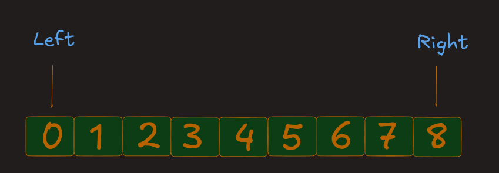
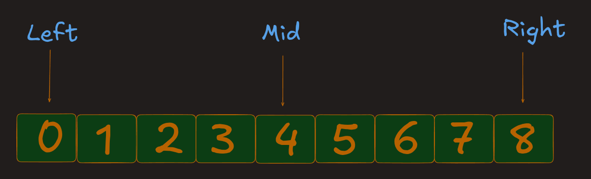
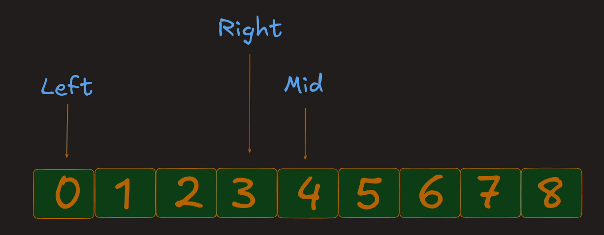
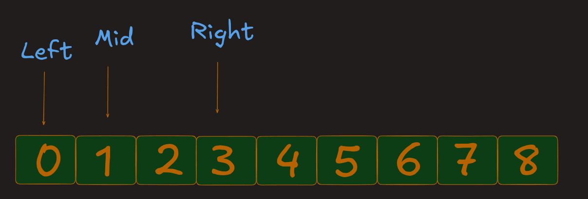
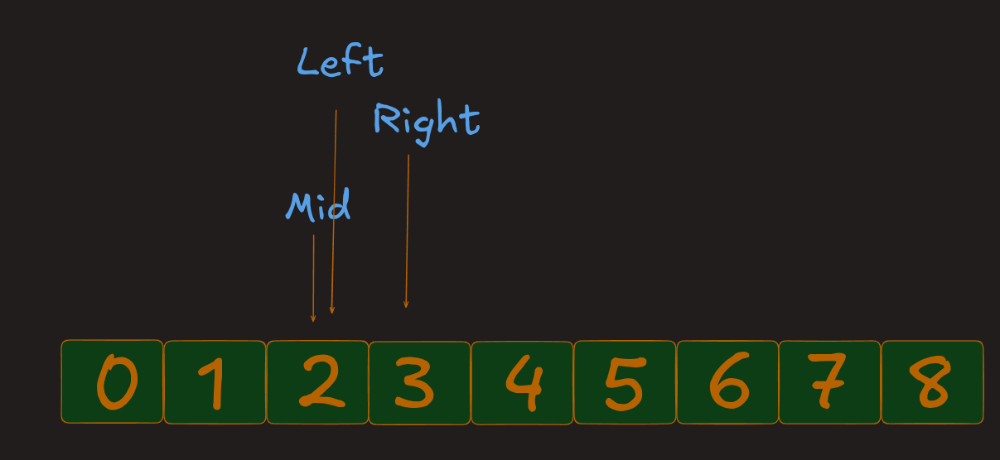
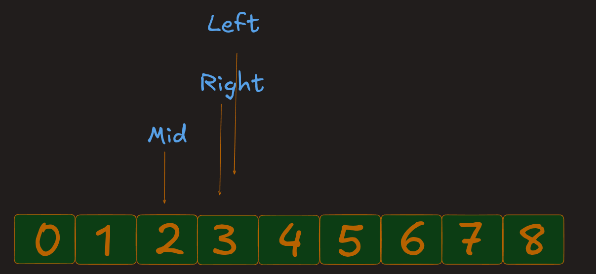
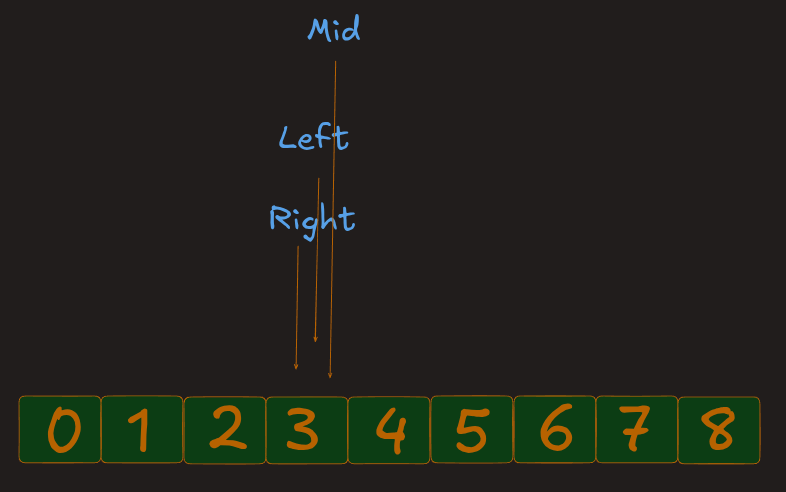
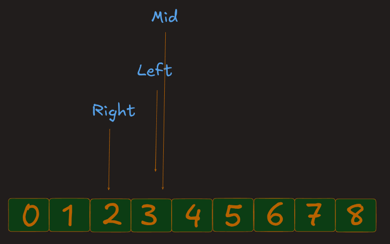
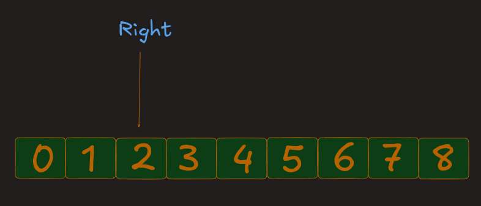

# LeetCode 69 – Sqrt(x)

**Difficulty:** Easy  
**Topic:** Binary Search  
**Problem Link:** [LeetCode 69 – Sqrt(x)](https://leetcode.com/problems/sqrtx/)

---

## 1. Problem Understanding

You are given a non-negative integer `x`.

Find the square root of `x` and return it as an integer. If the square root is not a whole number, return the integer part by rounding down.

**Important:** Do not use built-in functions such as `Math.sqrt()`, `Math.pow()`, or `x ** 0.5`.

## 2. First, Understand What a Square Root Is

A square root is a number that, when multiplied by itself, gives the original number.

| Number | Square | Result |
|---:|---:|---:|
| 1 | 1 × 1 | 1 |
| 2 | 2 × 2 | 4 |
| 3 | 3 × 3 | 9 |
| 4 | 4 × 4 | 16 |
| 5 | 5 × 5 | 25 |
| 6 | 6 × 6 | 36 |
| 7 | 7 × 7 | 49 |
| 8 | 8 × 8 | 64 |

For example:

\[
\sqrt{25}=5
\]

Because:

\[
5 \times 5 = 25
\]

### What if the number is not a perfect square?

Suppose `x = 8`.

- `2 × 2 = 4`
- `3 × 3 = 9`

The square root of 8 is between 2 and 3. Since we must round down, the answer is `2`.

**Our goal:** Find the largest integer `n` such that:

\[
n \times n \leq x
\]

## 3. Why Do We Use Binary Search?

We could check every number one by one, but that would be inefficient for large inputs.

Notice that square values are in increasing order:

```text
Number:  1   2   3   4   5   6   7   8
Square:  1   4   9  16  25  36  49  64
```

As the number increases, its square also increases. This lets us use Binary Search on the possible answers.

We start with this search range:

```js
let Left = 0;
let Right = x;
```

At each step, calculate the middle value and check its square:

- If `Mid * Mid === x`, we found the exact square root.
- If `Mid * Mid > x`, `Mid` is too large. Search the left half.
- If `Mid * Mid < x`, `Mid` is a valid candidate, but a larger answer may exist. Search the right half.

When the search ends, return `Right`. It contains the largest integer whose square is less than or equal to `x`.

## 4. Dry Run

Let's trace the algorithm with:

```text
Input: x = 8
```

Initial values:

```text
Left  = 0
Right = 8
```

We calculate the middle using:

\[
Mid = \left\lfloor \frac{Left + Right}{2} \right\rfloor
\]

### Iteration 1



```text
Left  = 0
Right = 8

Mid = Math.floor((0 + 8) / 2)
Mid = 4
```

Calculate:




```text
Mid * Mid = 4 * 4 = 16
```

Since `16 > 8`, the middle value is too large.


Update:

```js
Right = Mid - 1; // Right = 3
```


### Iteration 2




```text
Left  = 0
Right = 3

Mid = Math.floor((0 + 3) / 2)
Mid = 1
```

Calculate:

```text
Mid * Mid = 1 * 1 = 1
```

Since `1 < 8`, search the right half.

Update:

```js
Left = Mid + 1; // Left = 2
```

### Iteration 3



```text
Left  = 2
Right = 3

Mid = Math.floor((2 + 3) / 2)
Mid = 2
```

Calculate:

```text
Mid * Mid = 2 * 2 = 4
```

Since `4 < 8`, search the right half again.


Update:



```js
Left = Mid + 1; // Left = 3
```

### Iteration 4





```text
Left  = 3
Right = 3

Mid = Math.floor((3 + 3) / 2)
Mid = 3
```

Calculate:

```text
Mid * Mid = 3 * 3 = 9
```

Since `9 > 8`, the middle value is too large.


Update:




```js
Right = Mid - 1; // Right = 2
```

Now:

```text
Left  = 3
Right = 2
```

The condition `Left <= Right` is false, so the loop stops.

Return `Right`, which is `2`.



```text
Output: 2
```

## 5. Dry Run Table

| Iteration | Left | Right | Mid | Mid × Mid | Condition | Update |
|---:|---:|---:|---:|---:|---|---|
| 1 | 0 | 8 | 4 | 16 | 16 > 8 | `Right = 3` |
| 2 | 0 | 3 | 1 | 1 | 1 < 8 | `Left = 2` |
| 3 | 2 | 3 | 2 | 4 | 4 < 8 | `Left = 3` |
| 4 | 3 | 3 | 3 | 9 | 9 > 8 | `Right = 2` |

At the end:

```text
Left  = 3  // First value that is too large
Right = 2  // Largest value whose square is valid
```

Therefore, return `Right`.

## 6. Code Implementations

**Approach: Binary Search on Answer Space**

### JavaScript
```javascript
/**
 * @param {number} x
 * @return {number}
 */
var mySqrt = function (x) {
    let Left = 0;
    let Right = x;

    while (Left <= Right) {
        let Mid = Math.floor((Left + Right) / 2);

        if (Mid * Mid === x) {
            return Mid;
        } else if (Mid * Mid > x) {
            Right = Mid - 1;
        } else {
            Left = Mid + 1;
        }
    }

    return Right;
};
```

### Python 3
```python
class Solution:
    def mySqrt(self, x: int) -> int:
        left, right = 0, x

        while left <= right:
            mid = left + (right - left) // 2
            sq = mid * mid

            if sq == x:
                return mid
            elif sq > x:
                right = mid - 1
            else:
                left = mid + 1

        return right
```

## 7. Code Explanation

### Step 1: Initialize the search range

```js
let Left = 0;
let Right = x;
```

- `Left` is the starting value.
- `Right` is the ending value.
- The square root of a non-negative integer cannot be greater than `x`.

### Step 2: Continue while the search range is valid

```js
while (Left <= Right)
```

Keep searching while `Left` is less than or equal to `Right`.

### Step 3: Calculate the middle value

```js
let Mid = Math.floor((Left + Right) / 2);
```

Find the middle of the current search range.

### Step 4: Check for an exact square root

```js
if (Mid * Mid === x) {
    return Mid;
}
```

If the square of `Mid` equals `x`, return `Mid` immediately.

### Step 5: Search the left half

```js
else if (Mid * Mid > x) {
    Right = Mid - 1;
}
```

If the square is greater than `x`, `Mid` is too large. Move `Right` to `Mid - 1`.

### Step 6: Search the right half

```js
else {
    Left = Mid + 1;
}
```

If the square is smaller than `x`, move `Left` to `Mid + 1`. A larger valid answer may exist.

### Step 7: Return the answer

```js
return Right;
```

When the loop ends, `Right` is the largest integer whose square is less than or equal to `x`.

## 8. Why Do We Return `Right`?

This is the key idea in this problem.

For `x = 8`, the final values are:

```text
Left  = 3
Right = 2
```

Check both values:

- `2 × 2 = 4`, which is less than or equal to 8. So, 2 is valid.
- `3 × 3 = 9`, which is greater than 8. So, 3 is too large.

Therefore:

```text
Right = 2  // Largest valid answer
Left  = 3  // First value that is too large
```

We return `Right` because the problem asks for the largest integer whose square does not exceed `x`.

## 9. Edge Cases

| Input (`x`) | Output | Explanation |
|---:|---:|---|
| 0 | 0 | Square root of 0 is 0 |
| 1 | 1 | 1 × 1 = 1 |
| 2 | 1 | 1 × 1 = 1; round down |
| 4 | 2 | 2 × 2 = 4 |
| 8 | 2 | 3 × 3 = 9, which is too large |
| 16 | 4 | 4 × 4 = 16 |
| 25 | 5 | 5 × 5 = 25 |
| 30 | 5 | 6 × 6 = 36, which is too large |

## 10. Time and Space Complexity

### Time Complexity: `O(log x)`

Binary Search reduces the search range by approximately half in every iteration.

Therefore, the time complexity is:

\[
O(\log x)
\]

### Space Complexity: `O(1)`

The algorithm uses only a fixed number of variables:

- `Left`
- `Right`
- `Mid`

No additional data structure is required.

Therefore, the space complexity is:

\[
O(1)
\]

## 11. Important Concepts Learned

From this problem, we learned:

1. How to apply Binary Search to a numeric search space.
2. How to find a square root without using built-in functions.
3. How to choose the search direction using conditions.
4. How to find the maximum valid answer.
5. Why we return `Right` after the loop.
6. How to handle perfect and non-perfect square numbers.

## 12. Related Practice Problems

Try these problems to strengthen your Binary Search concepts:

| Problem | Difficulty |
|---|---|
| [Binary Search](https://leetcode.com/problems/binary-search/) | Easy |
| [Search Insert Position](https://leetcode.com/problems/search-insert-position/) | Easy |
| [Valid Perfect Square](https://leetcode.com/problems/valid-perfect-square/) | Easy |
| [Find Smallest Letter Greater Than Target](https://leetcode.com/problems/find-smallest-letter-greater-than-target/) | Easy |
| [Find Peak Element](https://leetcode.com/problems/find-peak-element/) | Medium |

---

## Final Takeaway

This problem is not just about finding a square root. It teaches an important Binary Search pattern: **finding the maximum valid value in a search space.**
