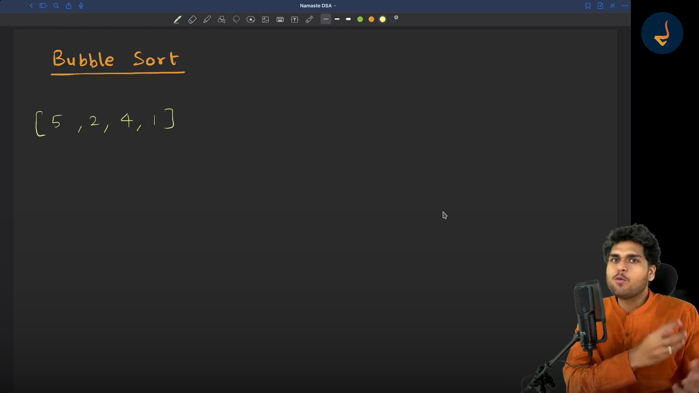
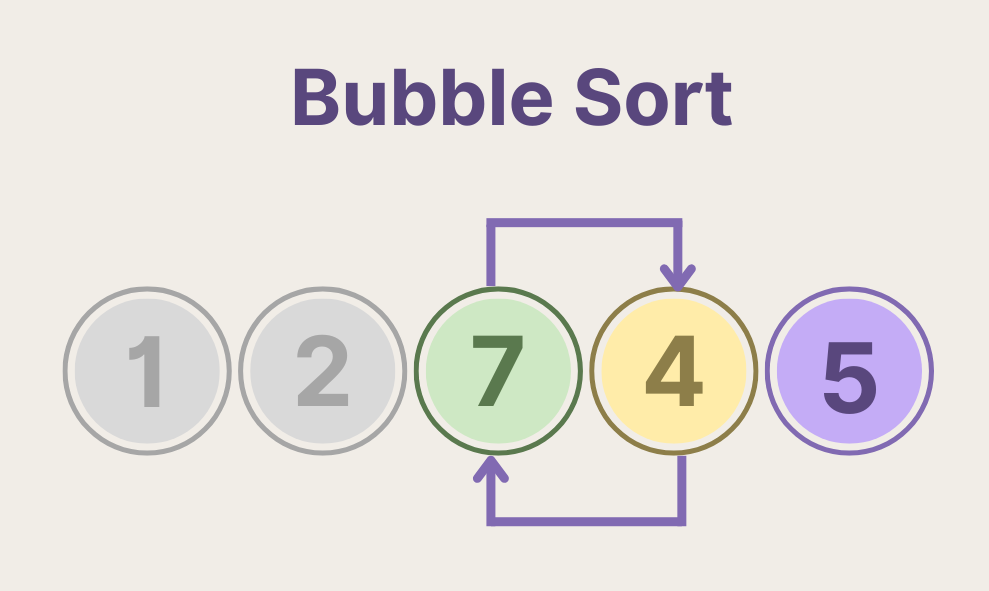
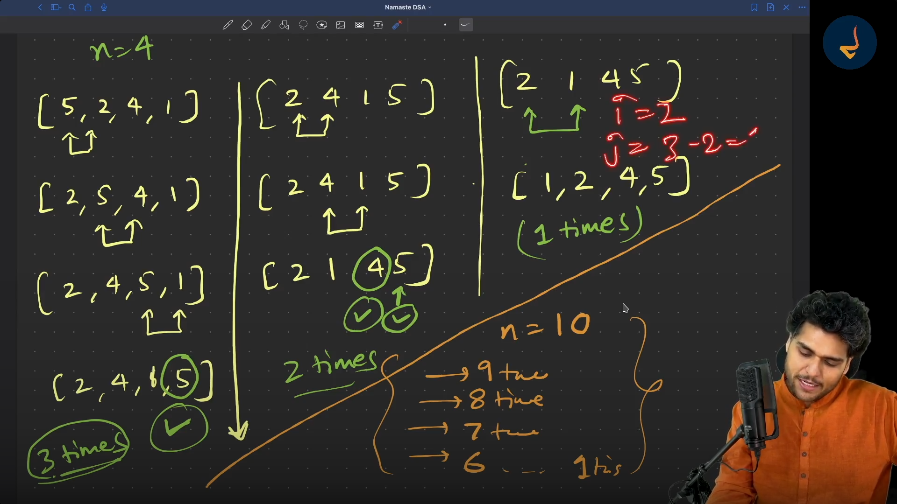
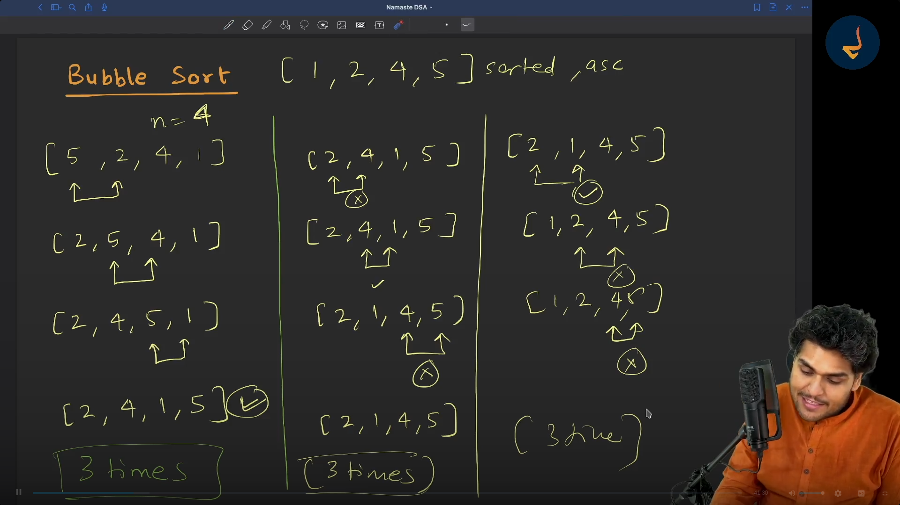
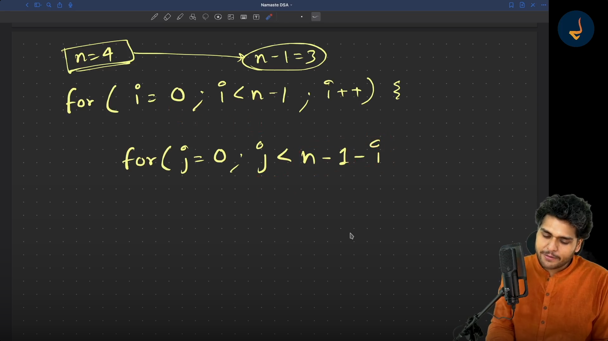
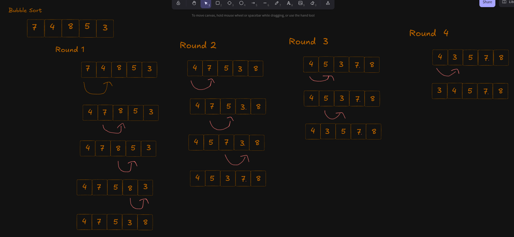
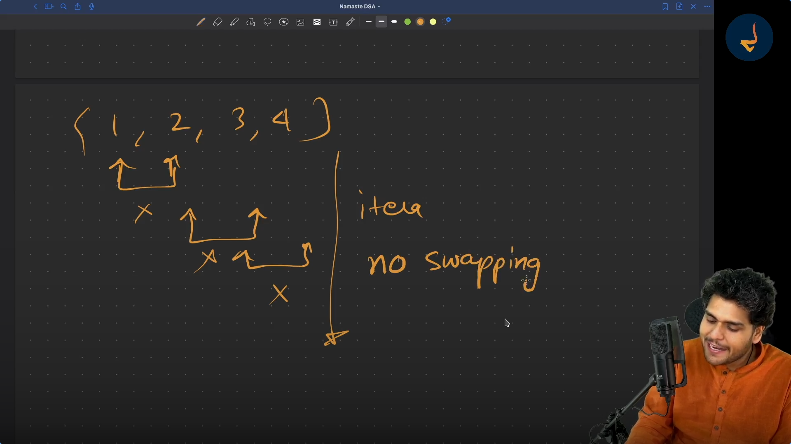
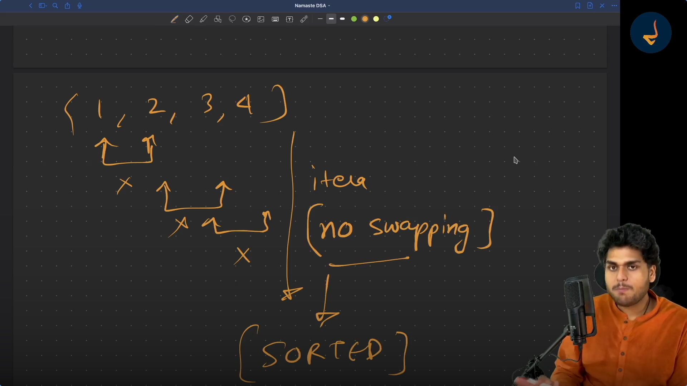

## What is Bubble Sort?

- **Bubble Sort** is a sorting algorithm that repeatedly compares array elements and swaps them based on specific conditions.
- These conditions help us to arrange elements in the correct order.



## In which order can Bubble Sort arrange elements in an array?

Bubble Sort can arrange elements in **both ascending order** and **descending order**, depending on the comparison condition used during the sorting process.

- **Ascending order:**
    
    When Bubble Sort compares two adjacent elements and swaps them if the **left element is greater than the right**, it moves larger elements toward the end. This results in the array being sorted from **smallest to largest**.
    
- **Descending order:**
    
    When the comparison condition is reversed — that is, swapping occurs if the **left element is smaller than the right** — the algorithm moves smaller elements toward the end. This sorts the array from **largest to smallest**.
    



## Why is it Called **Bubble Sort**?

**Bubble Sort** is called that because of how the biggest numbers

**"bubble up" to the end** of the list — just like bubbles rising in water.

---

### 💡 How It Works

- Bubble Sort looks at **two numbers next to each other**.
- If the first number is **bigger**, it **swaps** them.
- It keeps doing this again and again, across the whole list.

Each time it goes through the list, the **largest unsorted number moves toward the end**.

That’s why we say it’s “bubbling up.”

---

### 🧠 Why the Name Fits

- The biggest numbers **slowly rise to the end** of the list.
- It happens one small step at a time — just like **bubbles float to the surface**.
- After enough passes, the list becomes fully sorted.

---

### ⚠️ Is It Fast?

- Bubble Sort is **very easy to understand**, which makes it great for learning.
- But it’s **not very efficient** for large lists — so it’s not used in real-world programs much.

## 🧍‍♂️🧍‍♀️ Lining Up Students from Shortest to Tallest (Bubble Sort)

- Imagine you and your classmates are lining up from **shortest to tallest**.
This is exactly how **Bubble Sort** works!

`Here's what you do:`

1. Start at the **front** of the line.
2. Look at the **first two students** standing next to each other.
3. If the student on the **left is taller**, they **swap places**.
4. Move one step forward and do the same for the **next two students**.
5. Keep going until you reach the **end of the line**.
6. Now the **tallest student** will be at the very end — like a bubble rising up!
7. Go back to the **start of the line** and repeat the process.
8. Keep doing this until **no more swaps** are needed — now everyone is in order!

🎈 It’s just like bubbles in water — the tallest students slowly **“bubble” to the back** of the line, one by one!


### Example: Sorting the list `[5, 2, 4, 1]` in ascending order using Bubble Sort



## Example Of Bubble Sort

1. **Start:** `[5, 2, 4, 1]`
2. **First pass:**
    - Compare 5 and 2 → 5 is bigger, swap → `[2, 5, 4, 1]`
    - Compare 5 and 4 → 5 is bigger, swap → `[2, 4, 5, 1]`
    - Compare 5 and 1 → 5 is bigger, swap → `[2, 4, 1, 5]`*(Biggest number 5 “bubbles” to the end)*
3. **Second pass:**
    - Compare 2 and 4 → 2 is smaller, no swap → `[2, 4, 1, 5]`
    - Compare 4 and 1 → 4 is bigger, swap → `[2, 1, 4, 5]`
    - Compare 4 and 5 → 4 is smaller, no swap → `[2, 1, 4, 5]`
4. **Third pass:**
    - Compare 2 and 1 → 2 is bigger, swap → `[1, 2, 4, 5]`
    - Compare 2 and 4 → 2 is smaller, no swap → `[1, 2, 4, 5]`
    - Compare 4 and 5 → 4 is smaller, no swap → `[1, 2, 4, 5]`

Now the list is sorted: `[1, 2, 4, 5]`





## 🔄 How the Bubble Sort Algorithm Works

**Bubble Sort** is a way to sort an array (like a list of numbers) by

**repeatedly comparing and swapping** neighboring elements if they are in the wrong order.

🫧 **Think of it like bubbles in water**:

Each time you go through the list, the **largest number "bubbles up" to the end**,

just like a bubble rises to the top.

---

### 🔍 Example: Sorting `[5, 3, 8, 1]`

Let’s see what happens during the first pass:

1. Compare `5` and `3` → swap → `[3, 5, 8, 1]`
2. Compare `5` and `8` → no swap
3. Compare `8` and `1` → swap → `[3, 5, 1, 8]`

🫧 Now, `8` (the biggest number) has bubbled to the end of the list.

The algorithm will repeat this process until the entire list is sorted.

---

## 🔁 Bubble Sort – How the Loops Work (Made Easy)

---

### 🧠 The Main Idea

Bubble Sort uses **two loops** to sort a list:

- The **outer loop** counts how many steps we go through the list.
- The **inner loop** checks and swaps numbers that are in the wrong order.

Together, these loops help **move the biggest numbers to the end** of the list, step by step.



---

### 🔸 Outer Loop (The Big Loop)

- This loop goes over the list **many times**.
- After each full round, **one big number is in the right place** at the end.
- That means each new round needs **less work**, because part of the list is already sorted.

📌 Think of the outer loop like **rounds in a game** — each round helps sort the list more.

---

### 🔹 Inner Loop (The Worker Loop)

- This loop does the real work: it **looks at two numbers next to each other**.
- If the number on the left is **bigger**, it **swaps places** with the one on the right.
- It does this again and again, moving the big numbers to the end — like **bubbles floating up**.

📌 The inner loop is like a helper going through the list, fixing small problems.

`JavaScript Code`

```jsx

// ✅ Bubble Sort in JavaScript

function bubbleSort(arr) {
  let n = arr.length;

  // Outer loop - controls the number of passes
  for (let i = 0; i < n; i++) {
    // Inner loop - compares each pair of elements
    for (let j = 0; j < n - i - 1; j++) {
      // Swap if elements are in the wrong order
      if (arr[j] > arr[j + 1]) {
        // Swap arr[j] and arr[j + 1]
        let temp = arr[j];
        arr[j] = arr[j + 1];
        arr[j + 1] = temp;
      }
    }
  }

  return arr;
}

// Example usage:
const numbers = [5, 2, 9, 1, 5, 6];
console.log("Sorted array:", bubbleSort(numbers));
// Output: [1, 2, 5, 5, 6, 9]

```

`Python Code`

```python

# ✅ Bubble Sort in Python

def bubble_sort(arr):
    n = len(arr)

    # Outer loop - controls the number of passes
    for i in range(n):
        # Inner loop - compares each pair of elements
        for j in range(n - i - 1):
            # Swap if elements are in the wrong order
            if arr[j] > arr[j + 1]:
                # Swap arr[j] and arr[j + 1]
                arr[j], arr[j + 1] = arr[j + 1], arr[j]

    return arr

# Example usage
numbers = [5, 2, 9, 1, 5, 6]
print("Sorted array:", bubble_sort(numbers))
# Output: [1, 2, 5, 5, 6, 9]

```

## 🫧 Why the Largest Element Moves to the End in Each Pass

- In each pass, Bubble Sort compares **neighboring elements** and **swaps them** if they are in the wrong order.
- This causes **larger numbers to keep moving (or "bubbling") forward**, one step at a time.
- Just like **a bubble rises to the surface of water**, a large number rises to the end of the list through a series of swaps.

---

### 🔁 How it works:

- A large number gets compared multiple times in a single pass.
- Every time it’s bigger than the next number, it swaps and moves one step forward.
- By the end of the pass, it has reached the end — its **correct position**.

---

### 📌 Example:

Starting list: `[4, 2, 7, 1]`

- Pass 1 → `7` bubbles to the end → `[2, 4, 1, 7]`
- Pass 2 → `4` moves to position 2 → `[2, 1, 4, 7]`
- Pass 3 → `2` moves into place → `[1, 2, 4, 7]`

Each pass places the **next-largest number** in its final spot.

---

✅ This step-by-step bubbling is what gives **Bubble Sort** its name!

## 🧪 Step-by-Step Dry Run of Bubble Sort

Starting list:

`[7, 4, 8, 5, 3]`


---

### 🔁 Pass 1 (First full round):

Compare 7 and 4 → swap → `[4, 7, 8, 5, 3]`

Compare 7 and 8 → no swap

Compare 8 and 5 → swap → `[4, 7, 5, 8, 3]`

Compare 8 and 3 → swap → `[4, 7, 5, 3, 8]`

✅ Biggest number **8** is now at the end.

---

### 🔁 Pass 2:

Compare 4 and 7 → no swap

Compare 7 and 5 → swap → `[4, 5, 7, 3, 8]`

Compare 7 and 3 → swap → `[4, 5, 3, 7, 8]`

(We don’t compare 7 and 8 — 8 is already sorted)

✅ Second-biggest number **7** is now in place.

---

### 🔁 Pass 3:

Compare 4 and 5 → no swap

Compare 5 and 3 → swap → `[4, 3, 5, 7, 8]`

Compare 5 and 7 → no swap

✅ Third-biggest number **5** is in the right spot.

---

### 🔁 Pass 4:

Compare 4 and 3 → swap → `[3, 4, 5, 7, 8]`

Compare 4 and 5 → no swap

✅ Now the list is fully sorted.

---

### ✅ Final Sorted List:

`[3, 4, 5, 7, 8]`

## ⚡ Bubble Sort Optimizations

- Even if the array is already sorted (e.g., `[1, 2, 3, 4, 5]`), normal Bubble Sort still compares every element in every pass.
- This wastes time because it doesn’t know the array is already sorted.
- For example, a sorted array still takes **n-1 passes** even though it's already in order.



### ✅ Idea for Optimization

To improve performance, we need a way to check if the array is already sorted **during** the sorting process.

### ✔ Solution: Use a Flag Variable

- Introduce a variable (commonly called `swapped`) to track whether any elements were swapped in a pass.
- If **no elements are swapped** during a full pass, the array is already sorted.
- In that case, we can **exit the loop early**, saving time.

### 🧠 Benefits of Optimization

- Reduces unnecessary comparisons and passes.
- Best-case time complexity improves from **O(n²)** to **O(n)**.
- Simple to implement — just add one flag!



## Code Comparison:

### 💻 Code Comparison: Without Optimization

```jsx
let arr = [1, 2, 3, 4];
let n = arr.length;

for (let i = 0; i < n; i++) {
  for (let j = 0; j < n - 1; j++) {
    if (arr[j] > arr[j + 1]) {
      // Swap the elements
      let temp = arr[j];
      arr[j] = arr[j + 1];
      arr[j + 1] = temp;
    }
  }
}

console.log("Sorted array:", arr);

```

```
Comparisons: 12
Swaps: 0
Sorted array: [1, 2, 3, 4]

```

### ✅ Version With Optimization (Using swapped)

```jsx
let arr = [1, 2, 3, 4];
let n = arr.length;

for (let i = 0; i < n; i++) {
  let swapped = false;

  for (let j = 0; j < n - i - 1; j++) {
    if (arr[j] > arr[j + 1]) {
      // Swap the elements
      let temp = arr[j];
      arr[j] = arr[j + 1];
      arr[j + 1] = temp;
      swapped = true;
    }
  }

  // If no two elements were swapped in inner loop, array is sorted
  if (!swapped) break;
}

console.log("Sorted array:", arr);

```

```

Comparisons: 3
Swaps: 0
Sorted array: [1, 2, 3, 4]

```

---