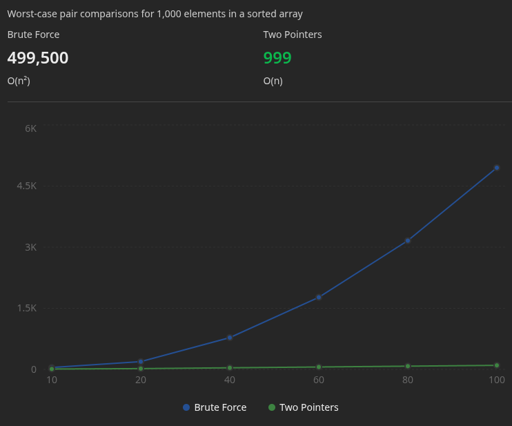
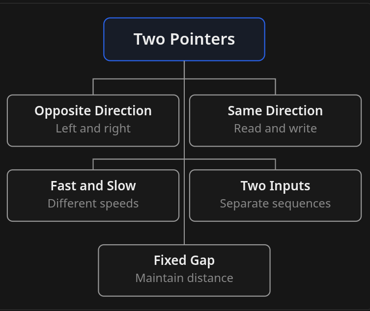

# **Part 1: Two Pointers Technique**

## **1. What is Two Pointers?**


Two Pointers is a problem-solving technique where we use two pointers to access, compare and process elements efficiently.

Instead of checking every possible combination using nested loops, we move these pointers based on certain conditions to find the required answer.

The main purpose of this technique is to reduce unnecessary operations and improve the performance of our solution.


Two Pointers is commonly used with:

- Arrays
- Strings
- Linked Lists





### **How does it work?**


```
let low = 0;
let high = arr.length - 1;
```


Here:

- `low` points to the first element.
- `high` points to the last element.
- `arr[low]` gives the value at the low pointer.
- `arr[high]` gives the value at the high pointer.

Based on the problem, we can move one or both pointers to find the answer.

**Remember:** A pointer simply represents a position in an array or string, or a reference to a node in a linked list. Both pointers do not necessarily start from opposite ends.

## **2. Why do we use Two Pointers?**

Suppose we have a sorted array and we want to find two elements whose sum is equal to a given target.

Using the brute force approach, we compare every element with every other element using nested loops.

However, using Two Pointers, we can avoid unnecessary comparisons by moving the pointers based on the sum.

### **Brute Force vs Two Pointers**

| Property        | Brute Force      | Two Pointers                |
| --------------- | ---------------- | --------------------------- |
| Approach        | Check every pair | Move pointers intelligently |
| Time Complexity | O(n²)            | O(n)                        |
| Auxiliary Space | O(1)             | O(1)                        |
| Comparisons     | More             | Fewer                       |
| Efficiency      | Lower            | Higher                      |

Brute Force

Two Pointers

01.5K3K4.5K6K10 elements50 elements100 elements

Maximum pair comparisons when searching for a target sum in a sorted array.

**Main objective:** Reduce unnecessary operations and improve time and space complexity whenever possible.

## **3. Types of Two Pointers**

Two Pointers can be divided into five common patterns based on where the pointers start, how they move and what relationship they maintain.



### **3.1 Opposite Direction Pointers**

In this pattern, one pointer starts from the beginning of the array, while the other starts from the end.

Both pointers move towards each other based on specific conditions.


**How does it work?**

- Initialize `low = 0`.
- Initialize `high = arr.length - 1`.
- Compare the elements at both pointers.
- Move one or both pointers based on the condition.
- Stop when the pointers meet or cross, depending on the problem.

#### **Basic Template**

```
let low = 0;
let high = arr.length - 1;

while (low < high) {
    if (condition) {
        low++;
    } else {
        high--;
    }
}
```

#### **Example: Two Sum in a Sorted Array**

Given a sorted array and a target, find two elements whose sum is equal to the target.

```
Input: arr = [1, 3, 5, 7, 9, 11]
Target = 14

Output: [3, 11]
```

**Approach:**

- If `sum === target` → Return the answer.
- If `sum < target` → Move `low++`.
- If `sum > target` → Move `high--`.

#### **JavaScript Solution**

```
function twoSum(arr, target) {
    let low = 0;
    let high = arr.length - 1;

    while (low < high) {
        let sum = arr[low] + arr[high];

        if (sum === target) {
            return [arr[low], arr[high]];
        } else if (sum < target) {
            low++;
        } else {
            high--;
        }
    }

    return [];
}
```


**When to use?**

When finding pairs in sorted arrays, reversing elements or comparing elements from opposite ends.

**Applications:** Two Sum II, Reverse String, Valid Palindrome, Container With Most Water.

**Time Complexity:** O(n)

**Space Complexity:** O(1)

### **3.2 Same Direction Pointers**

In this pattern, both pointers move in the same direction, usually from left to right.

One pointer reads the elements, while the other maintains the position where valid elements should be placed.


**How does it work?**

- Initialize both pointers at the beginning.
- The `read` pointer visits every element.
- The `write` pointer moves only when a valid element is found.
- Store or swap valid elements into their required positions.

#### **Basic Template**

```
let write = 0;

for (let read = 0; read < arr.length; read++) {
    if (condition) {
        arr[write] = arr[read];
        write++;
    }
}
```

#### **Example: Move Zeroes**

Move all zeroes to the end of the array while maintaining the relative order of non-zero elements.

```
Input:  [0, 1, 0, 3, 12]
Output: [1, 3, 12, 0, 0]
```

#### **JavaScript Solution**

```
function moveZeroes(nums) {
    let write = 0;

    for (let read = 0; read < nums.length; read++) {
        if (nums[read] !== 0) {
            let temp = nums[write];
            nums[write] = nums[read];
            nums[read] = temp;

            write++;
        }
    }
}
```

#### **Dry Run**

| Read | Write before | Array after operation |
| ---- | ------------ | --------------------- |
| 0    | 0            | [0, 1, 0, 3, 12]      |
| 1    | 0            | [1, 0, 0, 3, 12]      |
| 2    | 1            | [1, 0, 0, 3, 12]      |
| 3    | 1            | [1, 3, 0, 0, 12]      |
| 4    | 2            | [1, 3, 12, 0, 0]      |

#### **Important Concepts**

**In-place modification:** Modifying the original array without creating another array proportional to the input size.

**Relative order:** Maintaining the original ordering between the required elements.

```
Original: [0, 1, 0, 3, 12]

Non-zero elements: 1 → 3 → 12

Result:   [1, 3, 12, 0, 0]
```

The relative order of `1`, `3` and `12` remains unchanged.

**When to use?**

When removing unwanted elements, removing duplicates, modifying arrays in-place or preserving relative order.

**Applications:** Move Zeroes, Remove Element, Remove Duplicates, String Compression.

**Time Complexity:** O(n)

**Space Complexity:** O(1)

### **3.3 Fast and Slow Pointers**

In this pattern, both pointers move in the same direction but at different speeds.

Generally, the slow pointer moves one step, while the fast pointer moves two steps at a time.

This technique is also known as the **Tortoise and Hare technique**.

Iteration 0Iteration 1Iteration 2

**How does it work?**

- Initialize both pointers at the head of the linked list.
- Move `slow` by one node.
- Move `fast` by two nodes.
- Use their positions to determine the required result.

#### **Basic Template**

```
let slow = head;
let fast = head;

while (fast !== null && fast.next !== null) {
    slow = slow.next;
    fast = fast.next.next;
}
```


#### **Example 1: Middle of a Linked List**


```
function middleNode(head) {
    let slow = head;
    let fast = head;

    while (fast !== null && fast.next !== null) {
        slow = slow.next;
        fast = fast.next.next;
    }

    return slow;
}
```

When the fast pointer cannot move further, the slow pointer reaches the middle of the linked list.

If the linked list contains an even number of nodes, this implementation returns the second middle node.

#### **Example 2: Linked List Cycle**

If a linked list contains a cycle, the fast pointer will eventually meet the slow pointer.

This is known as **Floyd's Cycle Detection Algorithm**.

The last node points back to node 2 instead of null.

```
function hasCycle(head) {
    let slow = head;
    let fast = head;

    while (fast !== null && fast.next !== null) {
        slow = slow.next;
        fast = fast.next.next;

        if (slow === fast) {
            return true;
        }
    }

    return false;
}
```

**When to use?**

When detecting cycles, finding the middle node or identifying repeating sequences.

**Applications:** Linked List Cycle, Middle of Linked List, Happy Number, Find the Duplicate Number.

**Time Complexity:** O(n) for linked list traversal and cycle detection.

**Space Complexity:** O(1)

### **3.4 Two Input Pointers**

In this pattern, two pointers are used to traverse two separate arrays, strings or linked lists.

Each pointer belongs to a different input and moves independently based on specific conditions.


**How does it work?**

- Initialize `p1 = 0` for the first array.
- Initialize `p2 = 0` for the second array.
- Compare elements at both pointers.
- Move one or both pointers based on the condition.
- Process the remaining elements if required.

#### **Basic Template**

For comparing two sorted arrays:

```
let p1 = 0;
let p2 = 0;

while (p1 < arr1.length && p2 < arr2.length) {
    if (arr1[p1] < arr2[p2]) {
        p1++;
    } else if (arr1[p1] > arr2[p2]) {
        p2++;
    } else {
        // Process matching elements
        p1++;
        p2++;
    }
}
```

#### **Example: Merge Two Sorted Arrays**

```
Input:
arr1 = [1, 4, 7]
arr2 = [2, 3, 8]

Output:
[1, 2, 3, 4, 7, 8]
```

#### **JavaScript Solution**

```
function merge(arr1, arr2) {
    let p1 = 0;
    let p2 = 0;
    let result = [];

    while (p1 < arr1.length && p2 < arr2.length) {
        if (arr1[p1] <= arr2[p2]) {
            result.push(arr1[p1]);
            p1++;
        } else {
            result.push(arr2[p2]);
            p2++;
        }
    }

    while (p1 < arr1.length) {
        result.push(arr1[p1++]);
    }

    while (p2 < arr2.length) {
        result.push(arr2[p2++]);
    }

    return result;
}
```

#### **Dry Run**

| Array 1 value | Array 2 value | Result             |
| ------------- | ------------- | ------------------ |
| 1             | 2             | [1]                |
| 4             | 2             | [1, 2]             |
| 4             | 3             | [1, 2, 3]          |
| 4             | 8             | [1, 2, 3, 4]       |
| 7             | 8             | [1, 2, 3, 4, 7]    |
| End           | 8             | [1, 2, 3, 4, 7, 8] |

**When to use?**

When merging, comparing or finding common elements between two sequences.

**Applications:** Merge Sorted Arrays, Intersection of Arrays, Merge Two Sorted Lists, Is Subsequence.

**Time Complexity:** O(n + m)

**Auxiliary Space:** O(1), excluding the output array.

### **3.5 Fixed Gap Pointers**

In this pattern, two pointers maintain a fixed distance of K positions between them.

Initially, one pointer moves K steps ahead. After that, both pointers move at the same speed while maintaining the gap.

Initial gapMovement 1Movement 2

**How does it work?**

- Initialize both pointers at the starting position.
- Move the fast pointer K steps ahead.
- Move both pointers one step at a time.
- Maintain the gap until the required position is reached.

#### **Example: Find Kth Node From End**


#### **JavaScript Solution**

```
function kthFromEnd(head, k) {
    if (k <= 0) return null;

    let slow = head;
    let fast = head;

    // Create a gap of K positions
    for (let i = 0; i < k; i++) {
        if (fast === null) return null;
        fast = fast.next;
    }

    // Maintain the gap
    while (fast !== null) {
        slow = slow.next;
        fast = fast.next;
    }

    return slow;
}
```

When the fast pointer reaches `null`, the slow pointer points to the Kth node from the end.

**When to use?**

When finding an element at a specific distance from another element, especially when the total length is unknown.

**Applications:** Find Kth Node From End, Remove Nth Node From End.

**Time Complexity:** O(n)

**Space Complexity:** O(1)

## **4. How to Identify Two Pointers Problems?**

Identifying the correct pattern is one of the most important skills in problem-solving.

Whenever you read a question, look for the following keywords and requirements.

| Keywords or Requirements | Pattern to Consider    |
| ------------------------ | ---------------------- |
| Sorted array             | Opposite Direction     |
| Pair with given sum      | Opposite Direction     |
| Triplets or quadruplets  | Sorting + Two Pointers |
| Reverse array or string  | Opposite Direction     |
| Palindrome               | Opposite Direction     |
| Remove duplicates        | Same Direction         |
| In-place modification    | Same Direction         |
| Preserve relative order  | Read and Write         |
| Merge sorted arrays      | Two Input Pointers     |
| Find common elements     | Two Input Pointers     |
| Subsequence              | Two Input Pointers     |
| Detect cycle             | Fast and Slow          |
| Middle of linked list    | Fast and Slow          |
| Nth node from end        | Fixed Gap              |

**Remember:** These keywords help identify possible approaches. They do not guarantee that Two Pointers is always the best solution.

## **5. Important Pointer Conditions**

Understanding pointer conditions helps us avoid infinite loops, invalid indices and incorrect answers.

| Condition      | Meaning                             |
| -------------- | ----------------------------------- |
| `low++`        | Move one position towards the right |
| `high--`       | Move one position towards the left  |
| `low < high`   | Pointers have not met               |
| `low <= high`  | Include the meeting position        |
| `low === high` | Both pointers meet                  |
| `low > high`   | Both pointers have crossed          |

### **When to use&#x20;**`low < high`**?**

When two distinct elements are required.

For example, finding a pair with a given sum or swapping elements while reversing an array.

### **When to use&#x20;**`low <= high`**?**

When the meeting position also needs to be processed.

### **When to move one pointer?**

When the other element may still be required to find the correct answer.

**Example:** Two Sum in a sorted array.

### **When to move both pointers?**

When both current elements have been processed and are no longer required.

**Example:** Reversing an array.

```
function reverseArray(arr) {
    let low = 0;
    let high = arr.length - 1;

    while (low < high) {
        let temp = arr[low];
        arr[low] = arr[high];
        arr[high] = temp;

        low++;
        high--;
    }

    return arr;
}
```


## **6. Time and Space Complexity**

Two Pointers generally takes O(n) time because each pointer traverses the input at most a constant number of times.

For example, even if both pointers individually move N times:

\\[ O(n+n)=O(2n)=O(n) \\]

However, the complexity depends on the complete algorithm.

| Problem             | Time Complexity | Auxiliary Space   |
| ------------------- | --------------- | ----------------- |
| Reverse Array       | O(n)            | O(1)              |
| Two Sum (Sorted)    | O(n)            | O(1)              |
| Move Zeroes         | O(n)            | O(1)              |
| Remove Duplicates   | O(n)            | O(1)              |
| Linked List Cycle   | O(n)            | O(1)              |
| Merge Sorted Arrays | O(n + m)        | O(1)\*            |
| Sorting + Two Sum   | O(n log n)      | Sorting dependent |
| 3Sum                | O(n²)           | Sorting dependent |
| 4Sum                | O(n³)           | Sorting dependent |
| Trapping Rain Water | O(n)            | O(1)              |

\*Excluding output storage.

**Remember:** Using two pointers does not automatically make an algorithm O(n). Always consider sorting, nested loops and additional operations.

## **7. When Not to Use Two Pointers?**

Two Pointers is not suitable for every problem.

We should use it only when moving a pointer allows us to safely eliminate unnecessary elements without missing valid answers.

| Situation                                    | Better Approach to Consider     |
| -------------------------------------------- | ------------------------------- |
| Unsorted Two Sum requiring original indices  | Hash Map                        |
| Searching an element in a sorted array       | Binary Search                   |
| Repeated range sum queries                   | Prefix Sum                      |
| Finding maximum or minimum continuous ranges | Sliding Window, when applicable |
| Generating all possible combinations         | Backtracking                    |
| Problems with overlapping subproblems        | Dynamic Programming             |

## **8. Advantages and Disadvantages**

| Advantages                      | Disadvantages                       |
| ------------------------------- | ----------------------------------- |
| Reduces unnecessary comparisons | Not suitable for every problem      |
| Improves time complexity        | Some problems require sorting       |
| Usually requires less memory    | Incorrect movement can skip answers |
| Supports in-place modification  | Requires careful boundary handling  |
| Useful for large inputs         | Duplicate handling can be difficult |

## **9. Common Mistakes**

| Mistake                                  | Correct Approach                            |
| ---------------------------------------- | ------------------------------------------- |
| `high = arr.length`                      | Use `arr.length - 1` for the last index     |
| Forgetting pointer movement              | Ensure the loop makes progress              |
| Comparing pointer indices                | Compare actual values when required         |
| Applying sorted logic to unsorted arrays | Sort first or choose another approach       |
| Moving both pointers unnecessarily       | Move only the required pointer              |
| Ignoring duplicate elements              | Handle duplicates according to the question |
| Ignoring sorting complexity              | Include sorting in total complexity         |
| Accessing invalid linked list nodes      | Check for `null` before accessing `.next`   |
| Forgetting remaining elements            | Process leftover elements while merging     |

### **Important Edge Cases**

Always test your solution with:

- Empty array or linked list.
- Single element.
- Two elements.
- Duplicate elements.
- All elements equal.
- Negative numbers and zeroes.
- No valid answer.
- Multiple valid answers.
- Invalid K values.

## **10. Two Pointers vs Sliding Window**

Sliding Window is a specialized application of the Two Pointers technique.

The main difference is that Sliding Window maintains a continuous range of elements, while general Two Pointers does not necessarily maintain a continuous range.


**Two Pointers**

**Sliding Window**

| Property                  | Two Pointers               | Sliding Window              |
| ------------------------- | -------------------------- | --------------------------- |
| Main purpose              | Efficient traversal        | Maintain a continuous range |
| Pointer movement          | Same or opposite direction | Usually same direction      |
| Continuous range required | No                         | Yes                         |
| Common operations         | Compare, swap, move        | Expand, shrink, update      |
| Applications              | Pairs, merging, reversing  | Subarrays, substrings       |


## **📝 Practice Roadmap**

The following 15 carefully selected problems cover all five Two Pointers patterns, along with Sorting and Greedy Two Pointers.

Each problem uses Two Pointers as a primary, efficient approach. Solve them in the given order, from basic to advanced.

Abhishek tracker · Akanksha tracker

| Difficulty | Platform      | Question                                                                                                                                             | Subtopic                          | Local question | Local solution | Status |
| ---------- | ------------- | ---------------------------------------------------------------------------------------------------------------------------------------------------- | --------------------------------- | -------------- | -------------- | ------ |
| Easy       | LeetCode      | [344. Reverse String](https://leetcode.com/problems/reverse-string/?utm_source=chatgpt.com)                                                          | Opposite Direction                | N/A            | N/A            | To Do  |
| Easy       | LeetCode      | [125. Valid Palindrome](https://leetcode.com/problems/valid-palindrome/?utm_source=chatgpt.com)                                                      | Opposite Direction                | N/A            | N/A            | To Do  |
| Easy       | LeetCode      | [283. Move Zeroes](https://leetcode.com/problems/move-zeroes/?utm_source=chatgpt.com)                                                                | Same Direction                    | N/A            | N/A            | To Do  |
| Easy       | LeetCode      | [26. Remove Duplicates from Sorted Array](https://leetcode.com/problems/remove-duplicates-from-sorted-array/?utm_source=chatgpt.com)                 | Read and Write                    | N/A            | N/A            | To Do  |
| Easy       | LeetCode      | [21. Merge Two Sorted Lists](https://leetcode.com/problems/merge-two-sorted-lists/?utm_source=chatgpt.com)                                           | Two Input Pointers                | N/A            | N/A            | To Do  |
| Easy       | LeetCode      | [876. Middle of the Linked List](https://leetcode.com/problems/middle-of-the-linked-list/?utm_source=chatgpt.com)                                    | Fast and Slow                     | N/A            | N/A            | To Do  |
| Easy       | LeetCode      | [141. Linked List Cycle](https://leetcode.com/problems/linked-list-cycle/?utm_source=chatgpt.com)                                                    | Floyd's Cycle Detection           | N/A            | N/A            | To Do  |
| Medium     | LeetCode      | [167. Two Sum II](https://leetcode.com/problems/two-sum-ii-input-array-is-sorted/?utm_source=chatgpt.com)                                            | Opposite Direction                | N/A            | N/A            | To Do  |
| Medium     | GeeksforGeeks | [Count Pairs with Given Sum in a Sorted Array](https://www.geeksforgeeks.org/dsa/count-pairs-with-given-sum-in-sorted-array/?utm_source=chatgpt.com) | Two Pointers + Duplicate Handling | N/A            | N/A            | To Do  |
| Medium     | LeetCode      | [19. Remove Nth Node From End of List](https://leetcode.com/problems/remove-nth-node-from-end-of-list/?utm_source=chatgpt.com)                       | Fixed Gap                         | N/A            | N/A            | To Do  |
| Medium     | LeetCode      | [15. 3Sum](https://leetcode.com/problems/3sum/?utm_source=chatgpt.com)                                                                               | Sorting + Two Pointers            | N/A            | N/A            | To Do  |
| Medium     | TakeUForward  | [4 Sum](https://takeuforward.org/practice/dsa/4-sum?utm_source=chatgpt.com)                                                                          | Advanced Sorting + Two Pointers   | N/A            | N/A            | To Do  |
| Medium     | LeetCode      | [11. Container With Most Water](https://leetcode.com/problems/container-with-most-water/?utm_source=chatgpt.com)                                     | Greedy + Two Pointers             | N/A            | N/A            | To Do  |
| Medium     | LeetCode      | [881. Boats to Save People](https://leetcode.com/problems/boats-to-save-people/?utm_source=chatgpt.com)                                              | Sorting + Greedy Two Pointers     | N/A            | N/A            | To Do  |
| Hard       | LeetCode      | [42. Trapping Rain Water](https://leetcode.com/problems/trapping-rain-water/?utm_source=chatgpt.com)                                                 | Advanced Two Pointers             | N/A            | N/A            | To Do  |

