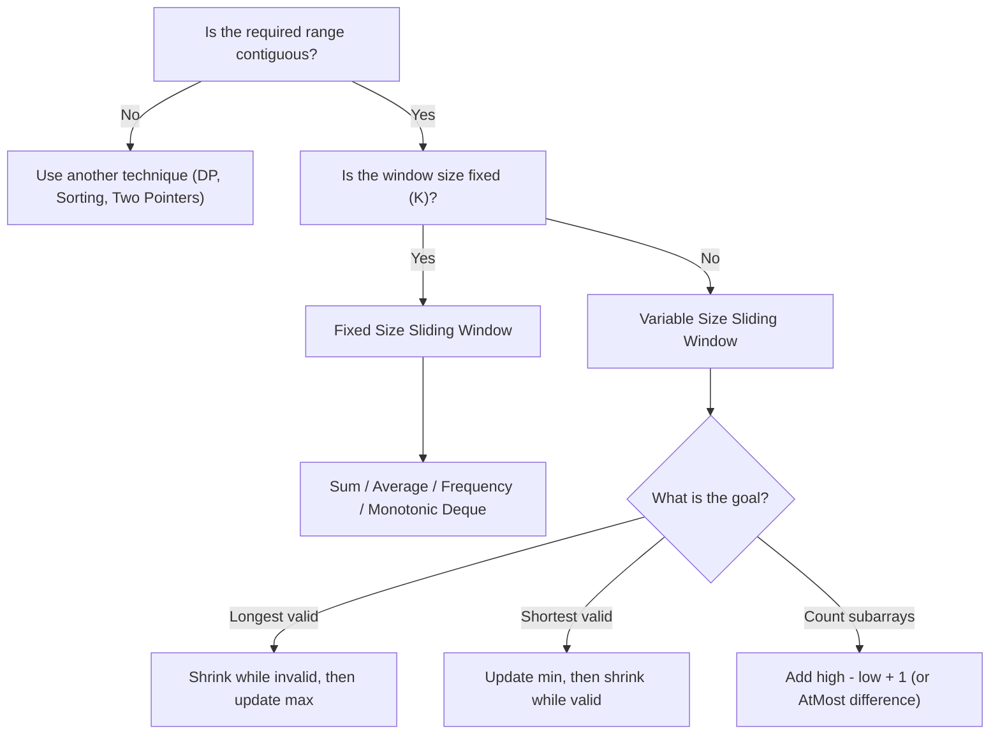

# Part 2: Sliding Window Technique

The Sliding Window Technique is one of the most important problem-solving patterns in Data Structures and Algorithms (DSA). It helps us efficiently solve problems involving contiguous subarrays, substrings, sums, frequencies, and conditions.

These notes cover everything from beginner-level fundamentals to advanced interview patterns using JavaScript.

---

## Table of Contents

| # | Topic |
| - | ----- |
| 1 | [What is Sliding Window?](#1-what-is-sliding-window) |
| 2 | [Why do we use Sliding Window?](#2-why-do-we-use-sliding-window) |
| 3 | [Important Fundamental Concepts](#3-important-fundamental-concepts) |
| 4 | [Types of Sliding Window](#4-types-of-sliding-window) |
| 5 | [Fixed Size Sliding Window](#5-fixed-size-sliding-window) |
| 6 | [Variable Size Sliding Window](#6-variable-size-sliding-window) |
| 7 | [Fixed Size vs Variable Size Sliding Window](#7-fixed-size-vs-variable-size-sliding-window) |
| 8 | [Important Sliding Window Patterns](#8-important-sliding-window-patterns) |
| 9 | [Sliding Window with Frequency Tracking](#9-sliding-window-with-frequency-tracking) |
| 10 | [Counting Valid Subarrays](#10-counting-valid-subarrays) |
| 11 | [At Most K, At Least K and Exactly K](#11-at-most-k-at-least-k-and-exactly-k) |
| 12 | [Advanced Sliding Window — Monotonic Deque](#12-advanced-sliding-window--monotonic-deque) |
| 13 | [How to Identify Sliding Window Problems?](#13-how-to-identify-sliding-window-problems) |
| 14 | [When Not to Use Sliding Window](#14-when-not-to-use-sliding-window) |
| 15 | [Time and Space Complexity](#15-time-and-space-complexity) |
| 16 | [Advantages, Limitations and Common Mistakes](#16-advantages-limitations-and-common-mistakes) |
| 17 | [Frequently Asked Interview and Exam Questions](#17-frequently-asked-interview-and-exam-questions) |
| 18 | [Practice Roadmap](#18-practice-roadmap) |
| 19 | [Quick Revision Cheat Sheet](#19-quick-revision-cheat-sheet) |
| 20 | [Additional Learning Resources](#20-additional-learning-resources) |
| 21 | [Chapter Completion Checklist](#21-chapter-completion-checklist) |
| 22 | [Final Conclusion](#22-final-conclusion) |

---

## 1. What is Sliding Window?

Sliding Window is a problem-solving technique in which we maintain a continuous group of elements called a **window** and move it through an array or string to find the required answer efficiently.

Instead of processing the same elements repeatedly, we maintain useful information from the previous window and update it whenever the window moves.

### Real-life Example

Imagine you are travelling on a train and looking outside through a window.

As the train moves forward, some objects disappear from your view while new objects become visible. You do not need to observe everything from the beginning again.

The Sliding Window Technique follows a similar concept.

### Understanding Through an Array

```text
Active window — size 3

Array: [2, 4, 6, 8, 10, 12]

Window 1: [2, 4, 6]  8  10  12
Window 2:  2 [4, 6, 8] 10  12
Window 3:  2  4 [6, 8, 10] 12
Window 4:  2  4  6 [8, 10, 12]
```

Here, the window contains three consecutive elements. Every time the window moves one position to the right, one element leaves and one new element enters.

### Common Applications

- Maximum or minimum sum of consecutive elements.
- Maximum or minimum average.
- Longest or shortest valid subarray.
- Longest or shortest substring.
- Counting valid subarrays or substrings.
- Finding anagrams and permutations.
- Finding the maximum or minimum element in every window.

---

## 2. Why do we use Sliding Window?

The main purpose of Sliding Window is to reduce unnecessary calculations and improve time complexity.

Suppose we want to find the maximum sum of three consecutive elements.

```js
arr = [2, 4, 6, 8, 10, 12];
k = 3;
```

### 2.1 Brute Force Approach

Calculate the sum of every possible window separately.

```text
Window 1: 2 + 4 + 6   = 12
Window 2: 4 + 6 + 8   = 18
Window 3: 6 + 8 + 10  = 24
Window 4: 8 + 10 + 12 = 30
```

The problem is that overlapping elements are calculated repeatedly.

For example, `4` and `6` are already included in the first window, but we calculate them again in the second window.

### 2.2 Sliding Window Approach

Calculate the first window's sum and reuse it to calculate the next window's sum.

```txt
NewSum= PreviousSum - Outgoing + Incoming
```


#### Dry Run

| Window       | Outgoing | Incoming | Calculation  | Sum |
| ------------ | -------- | -------- | ------------ | --- |
| `[2, 4, 6]`  | —        | —        | `2 + 4 + 6`  | 12  |
| `[4, 6, 8]`  | 2        | 8        | `12 − 2 + 8` | 18  |
| `[6, 8, 10]` | 4        | 10       | `18 − 4 + 10`| 24  |
| `[8, 10, 12]`| 6        | 12       | `24 − 6 + 12`| 30  |

Maximum sum = `30`

### 2.3 Brute Force vs Sliding Window


| Property                     | Brute Force             | Sliding Window        |
| ---------------------------- | ----------------------- | --------------------- |
| Approach                     | Recalculate every window| Reuse previous result |
| Time Complexity              | `O(n × k)`              | `O(n)`                |
| Auxiliary Space Complexity   | `O(1)`                  | `O(1)`                |
| Total Space Including Input  | `O(n)`                  | `O(n)`                |
| First Window                 | `O(k)`                  | `O(k)`                |
| Each Next Window             | `O(k)`                  | `O(1)`                |
| Number of Windows            | `n − k + 1`             | `n − k + 1`           |
| Window Movement              | Recalculate all elements| Remove old, add new   |
| Repeated Calculations        | More                    | Fewer                 |
| Overlapping Elements         | Calculated again        | Reused                |
| Efficiency                   | Lower                   | Higher                |

Where `n` is the array length and `k` is the fixed window size.


**Main objective:** Don't recalculate information that you have already calculated.

---

## 3. Important Fundamental Concepts

Before learning the different types of Sliding Window, we need to understand subarrays, substrings, subsequences and pointers.

### 3.1 Subarray

A subarray is a contiguous part of an array.

```text
Array: [1, 2, 3, 4, 5]

Valid:   [1, 2, 3]
Valid:   [3, 4, 5]
Invalid: [1, 3, 5]
```

### 3.2 Substring

A substring is a contiguous part of a string.

```text
String: "abcdef"

Valid:   "abc"
Valid:   "cde"
Invalid: "ace"
```

### 3.3 Subsequence

A subsequence is formed by selecting elements while maintaining their original relative order. The elements do not need to be continuous.

```text
Array: [1, 2, 3, 4, 5]

Valid: [1, 3, 5]
Valid: [2, 4]
Valid: [1, 2, 5]
```


| Property        | Subarray         | Substring        | Subsequence              |
| --------------- | ---------------- | ---------------- | ------------------------ |
| Used with       | Array            | String           | Both                     |
| Contiguous      | Yes              | Yes              | Not required             |
| Original order  | Maintained       | Maintained       | Maintained               |
| Sliding Window  | Often applicable | Often applicable | Generally not applicable |

### 3.4 Understanding Two Pointers

Sliding Window generally uses two pointers to represent the starting and ending positions of the current window.

```js
let low = 0;
let high = 0;
```


| Pointer  | Purpose                     |
| -------- | --------------------------- |
| `low`    | Starting index of the window|
| `high`   | Ending index of the window  |
| `high++` | Expand towards the right    |
| `low++`  | Shrink from the left        |

#### Window Size Formula

$$
\text{Window Size} = \text{high} - \text{low} + 1
$$

We add `1` because both the starting and ending indices are included in the window.

### 3.5 Important Terminology

| Term             | Meaning                                             |
| ---------------- | --------------------------------------------------- |
| Incoming element | New element entering the window                     |
| Outgoing element | Element leaving the window                          |
| Expand           | Increase the window size                            |
| Shrink           | Decrease the window size                            |
| Window state     | Information maintained inside the window            |
| Valid window     | Window satisfying the required condition            |
| Invalid window   | Window not satisfying the required condition        |

Window state can be a sum, product, frequency map, set, count or another useful data structure.

---

## 4. Types of Sliding Window

Sliding Window is mainly divided into two types based on how the window size is maintained.


| Type                         | Description                                                               |
| ---------------------------- | ------------------------------------------------------------------------- |
| Fixed Size Sliding Window    | Window size remains constant throughout the traversal after initialization.|
| Variable Size Sliding Window | Window size changes dynamically according to a condition.                 |

Both types maintain a contiguous range. The main difference is **when and why we expand or shrink the window.**

---

## 5. Fixed Size Sliding Window

### 5.1 Definition

Fixed Size Sliding Window is a technique where we maintain a window of exactly `K` consecutive elements and move it through an array or string to calculate the required result.

After building the first complete window, we remove one outgoing element and add one incoming element whenever the window moves.


### 5.2 How does it work?

The entire process is divided into two phases.

#### Phase 1: Build the first window

Initially, add elements until the window reaches the required size.

```text
Array = [2, 4, 6, 8, 10, 12]
k = 3

[2]       → Size = 1
[2, 4]    → Size = 2
[2, 4, 6] → Size = 3  (First window completed)
```

#### Phase 2: Slide the window

Remove the first element and add the next element to maintain the same window size.

```text
[2, 4, 6] → [4, 6, 8] → [6, 8, 10] → [8, 10, 12]
```


### 5.3 Important Formulas

| Formula                     | Purpose                                  |
| --------------------------- | ---------------------------------------- |
| `high - low + 1`            | Current window size                      |
| `high - low + 1 === k`      | Check complete window                    |
| `sum - outgoing + incoming` | Calculate new window sum                 |
| `n - k + 1`                 | Total possible windows                   |
| `sum / k`                   | Window average                           |
| `i - k`                     | Outgoing index when `i` is incoming index|

These formulas assume a valid fixed window size: `1 <= k <= n`.

### 5.4 General Algorithm

1. Initialize the starting pointer and window state.
2. Traverse the array using the ending pointer.
3. Add the incoming element.
4. Check whether the window has reached size `K`.
5. Update the required answer.
6. Remove the outgoing element.
7. Move the starting pointer forward.
8. Repeat until the traversal is completed.

### 5.5 General Code Template

```js
let low = 0;

for (let high = 0; high < arr.length; high++) {

    // Step 1: Add incoming element

    // Step 2: Check window size
    if (high - low + 1 === k) {

        // Step 3: Update the answer

        // Step 4: Remove outgoing element

        // Step 5: Move starting pointer
        low++;
    }
}
```

The operations inside the window depend on the problem.

### 5.6 Example: Maximum Sum Subarray of Size K

**Problem statement:** Given an integer array and an integer `K`, find the maximum sum of any contiguous subarray of size `K`.

```text
Input:  arr = [2, 1, 5, 1, 3, 2], k = 3
Output: 9
Explanation: The subarray [5, 1, 3] has the maximum sum.
```

#### JavaScript Implementation

```js
function maxSubarraySum(arr, k) {
    if (k <= 0 || k > arr.length) return null;

    let low = 0;
    let sum = 0;
    let maxSum = -Infinity;

    for (let high = 0; high < arr.length; high++) {
        // Add incoming element
        sum += arr[high];

        // Check complete window
        if (high - low + 1 === k) {
            // Update answer
            maxSum = Math.max(maxSum, sum);

            // Remove outgoing element
            sum -= arr[low];

            // Slide the window
            low++;
        }
    }

    return maxSum;
}
```

#### Dry Run

| Low | High | Current Window | Sum | Max Sum |
| --- | ---- | -------------- | --- | ------- |
| 0   | 0    | `[2]`          | 2   | −∞      |
| 0   | 1    | `[2, 1]`       | 3   | −∞      |
| 0   | 2    | `[2, 1, 5]`    | 8   | 8       |
| 1   | 3    | `[1, 5, 1]`    | 7   | 8       |
| 2   | 4    | `[5, 1, 3]`    | 9   | 9       |
| 3   | 5    | `[1, 3, 2]`    | 6   | 9       |

The table shows the window immediately after adding the incoming element and before removing the outgoing element.

Final answer: `9`

#### Alternative Implementation

For fixed-size sum problems, we can also calculate the first window separately.

```js
function maxSubarraySum(arr, k) {
    if (k <= 0 || k > arr.length) return null;

    let sum = 0;

    // Build first window
    for (let i = 0; i < k; i++) {
        sum += arr[i];
    }

    let maxSum = sum;

    // Slide the window
    for (let i = k; i < arr.length; i++) {
        sum = sum - arr[i - k] + arr[i];
        maxSum = Math.max(maxSum, sum);
    }

    return maxSum;
}
```

Both implementations have the same time and auxiliary space complexity.

#### Complexity Analysis

| Property                   | Complexity |
| -------------------------- | ---------- |
| First window               | `O(k)`     |
| Remaining windows          | `O(n − k)` |
| Total time complexity      | `O(n)`     |
| Auxiliary space complexity | `O(1)`     |

### 5.7 How to Identify Fixed Size Sliding Window Problems?

Look for requirements such as:

- Subarray of size `K`.
- Exactly `K` consecutive elements.
- Maximum or minimum sum of `K` elements.
- Maximum average of a subarray of length `K`.
- Every substring of a particular length.
- Find anagrams of a given pattern.

**Key observation:** The required window length is known before traversal begins.

---

## 6. Variable Size Sliding Window

### 6.1 Definition

Variable Size Sliding Window is a technique where the window size dynamically increases or decreases depending on a condition.

Unlike Fixed Size Sliding Window, we do not maintain a constant window length.

We expand the window to explore more elements and shrink it whenever required by the problem's condition.


### 6.2 Understanding the Concept

Suppose we want to find the longest subarray whose sum is less than or equal to `6`.


```text
arr = [2, 1, 3, 4, 1]
target = 6
```

The window can grow as long as its sum does not exceed the target.

The longest valid window is `[2, 1, 3]`, with length `3`.

### 6.3 Fundamental Concepts

| Concept          | Description                                |
| ---------------- | ------------------------------------------ |
| Window State     | Information maintained inside the window   |
| Window Condition | Rule determining whether the window is valid|
| Expand           | Add incoming element                       |
| Shrink           | Remove outgoing elements                   |
| Answer           | Required maximum, minimum or count         |

For the previous example:

```text
Window State     = Sum
Window Condition = Sum <= Target
Expand           = Add incoming element
Shrink           = Remove outgoing element
Required Answer  = Maximum valid window length
```

### 6.4 How does it work?

**Step 1: Expand the window** — Add the incoming element.

```js
sum += arr[high];
```

**Step 2: Check the condition** — Determine whether the current window is valid.

```js
sum <= target;
```

**Step 3: Shrink if necessary** — If the window becomes invalid, remove elements until it becomes valid again.

```js
while (sum > target) {
    sum -= arr[low];
    low++;
}
```

**Step 4: Update the answer** — After restoring validity, calculate the current window length.

```js
maxLength = Math.max(
    maxLength,
    high - low + 1
);
```

This is the standard approach for longest-window problems with a suitable monotonic condition.

### 6.5 General Code Template

```js
let low = 0;

for (let high = 0; high < arr.length; high++) {

    // Step 1: Add incoming element

    while (windowIsInvalid) {
        // Step 2: Remove outgoing element

        // Step 3: Shrink the window
        low++;
    }

    // Step 4: Update longest valid window
}
```

For shortest-window problems, the shrinking and answer-update rules are different.

### 6.6 Example: Longest Subarray With Sum At Most K

**Problem statement:** Given an array of non-negative integers and a non-negative target, return the length of the longest contiguous subarray whose sum is less than or equal to the target.

```text
Input:  arr = [2, 1, 3, 4, 1], target = 6
Output: 3
```

#### JavaScript Implementation

```js
function longestSubarray(arr, target) {
    let low = 0;
    let sum = 0;
    let maxLength = 0;

    for (let high = 0; high < arr.length; high++) {
        // Expand the window
        sum += arr[high];

        // Shrink while invalid
        while (sum > target) {
            sum -= arr[low];
            low++;
        }

        // Update longest valid window
        maxLength = Math.max(
            maxLength,
            high - low + 1
        );
    }

    return maxLength;
}
```

#### Dry Run

| High | Incoming | Sum Before Shrinking | Removed   | Valid Window | Max Length |
| ---- | -------- | -------------------- | --------- | ------------ | ---------- |
| 0    | 2        | 2                    | —         | `[2]`        | 1          |
| 1    | 1        | 3                    | —         | `[2, 1]`     | 2          |
| 2    | 3        | 6                    | —         | `[2, 1, 3]`  | 3          |
| 3    | 4        | 10                   | 2, 1, 3   | `[4]`        | 3          |
| 4    | 1        | 5                    | —         | `[4, 1]`     | 3          |

Final answer: `3`

#### Complexity Analysis

- **Time Complexity:** `O(n)`
- **Auxiliary Space Complexity:** `O(1)`

#### Important Condition

This algorithm works because the elements are non-negative. Adding an element cannot decrease the sum, and removing an element cannot increase it.

When negative numbers are present, this property may no longer hold.

### 6.7 Why do we use `while` instead of `if`?

Consider the following example:

```text
Current window = [2, 1, 3, 4]
Sum = 10, Target = 6
```

Removing only one element is not sufficient:

```text
Remove 2 → Sum = 8 → Still invalid
Remove 1 → Sum = 7 → Still invalid
Remove 3 → Sum = 4 → Valid
```

An `if` statement removes at most one element per iteration. A `while` loop can remove multiple elements until the condition is satisfied.

That is why repeated shrinking generally requires a `while` loop.

---

## 7. Fixed Size vs Variable Size Sliding Window

| Property              | Fixed Size                  | Variable Size               |
| --------------------- | --------------------------- | --------------------------- |
| Window Size           | Constant (`3 → 3 → 3`)      | Dynamic (`2 → 4 → 2`)       |
| Window Length         | Known in advance            | Calculated during traversal |
| Main Objective        | Maintain size `K`           | Maintain required condition |
| Expanding             | Add incoming element        | Add incoming element        |
| Shrinking             | Maintain fixed size         | Based on condition          |
| Common Loop Structure | `for` + `if`                | `for` + `while`             |
| Elements Removed      | Usually one                 | One or multiple             |
| Answer Update         | When size equals `K`        | Based on validity           |
| Time Complexity       | Usually `O(n)`              | Usually `O(n)`              |
| Applications          | Sum, average, anagrams      | Longest, shortest, counting |


---

## 8. Important Sliding Window Patterns

Most Sliding Window problems can be divided into a limited number of patterns. Understanding these patterns is more useful than memorizing individual solutions.

### 8.1 Maximum and Minimum Sum

**When to use:** The question asks for the maximum or minimum sum of `K` consecutive elements.

Maintain the current window sum.

```js
let maxSum = -Infinity;
let minSum = Infinity;
let sum = 0;
let low = 0;

for (let high = 0; high < arr.length; high++) {
    sum += arr[high];

    if (high - low + 1 === k) {
        maxSum = Math.max(maxSum, sum);
        minSum = Math.min(minSum, sum);

        sum -= arr[low];
        low++;
    }
}
```

#### Why initialize with `Infinity`?

Suppose all the elements are negative:

```text
arr = [-5, -2, -8], k = 2
Possible sums: -7, -10
Maximum sum = -7
```

If we initialize `maxSum = 0`, our answer will incorrectly remain zero.

| Required Answer | Initialization |
| --------------- | -------------- |
| Maximum sum     | `-Infinity`    |
| Minimum sum     | `Infinity`     |
| Maximum length  | `0`            |
| Minimum length  | `Infinity`     |
| Count           | `0`            |

### 8.2 Maximum and Minimum Average

When the window size is fixed, average can be calculated using the window sum.

$$
\text{Average} = \frac{\text{Window Sum}}{K}
$$

For a constant window size, the window with the maximum sum will also have the maximum average.

```js
return maxSum / k;
```

Practice problem: [643. Maximum Average Subarray I](https://leetcode.com/problems/maximum-average-subarray-i/)

### 8.3 Longest Valid Window

**Objective:** Find the largest contiguous range satisfying a condition.

**Standard rule:** Expand the window, shrink while invalid, and update the answer after the window becomes valid.

```js
let low = 0;
let maxLength = 0;

for (let high = 0; high < arr.length; high++) {
    // Add incoming element

    while (windowIsInvalid) {
        // Remove outgoing element
        low++;
    }

    maxLength = Math.max(
        maxLength,
        high - low + 1
    );
}
```

**Applications:** Longest Substring Without Repeating Characters, Max Consecutive Ones III, Fruit Into Baskets.

### 8.4 Shortest Valid Window

**Objective:** Find the smallest contiguous range satisfying a condition.

We expand the window until it becomes valid. Once valid, we try to shrink it to find a smaller valid window.

**Standard rule:** Expand until valid, update the answer, and continue shrinking while valid.

#### Example: Minimum Size Subarray Sum

```text
Input:  nums = [2, 3, 1, 2, 4, 3], target = 7
Output: 2
Explanation: [4, 3] is the shortest subarray whose sum is at least 7.
```

#### JavaScript Implementation

```js
function minSubArrayLen(target, nums) {
    let low = 0;
    let sum = 0;
    let minLength = Infinity;

    for (let high = 0; high < nums.length; high++) {
        // Expand the window
        sum += nums[high];

        // Shrink while valid
        while (sum >= target) {
            // Update answer before shrinking
            minLength = Math.min(
                minLength,
                high - low + 1
            );

            // Remove outgoing element
            sum -= nums[low];
            low++;
        }
    }

    return minLength === Infinity ? 0 : minLength;
}
```

This implementation assumes non-negative elements and a positive target.

#### Dry Run

| Valid Window   | Sum | Length | Minimum Length |
| -------------- | --- | ------ | -------------- |
| `[2, 3, 1, 2]` | 8   | 4      | 4              |
| `[3, 1, 2, 4]` | 10  | 4      | 4              |
| `[1, 2, 4]`    | 7   | 3      | 3              |
| `[2, 4, 3]`    | 9   | 3      | 3              |
| `[4, 3]`       | 7   | 2      | 2              |

Final answer: `2`

### 8.5 Longest vs Shortest Window


| Longest Window         | Shortest Window            |
| ---------------------- | -------------------------- |
| Find maximum valid length | Find minimum valid length |
| Shrink while invalid   | Shrink while valid         |
| Update after shrinking | Update before removing     |
| Use `Math.max()`       | Use `Math.min()`           |
| Initialize with `0`    | Initialize with `Infinity` |


**Remember:** The standard templates work when the problem's condition supports forward-only pointer movement.

---

## 9. Sliding Window with Frequency Tracking

Sometimes maintaining the window sum or length is not enough. We also need information about the elements present inside the window and their frequencies.

For this purpose, we can use a Set, Hash Map or frequency array.

### 9.1 Understanding Frequency


```text
Window = [a, b, a, c, b]

Frequency:
a → 2
b → 2
c → 1
```

### 9.2 Adding an Element

```js
map.set(
    element,
    (map.get(element) || 0) + 1
);
```

If the element already exists, increase its frequency. Otherwise, initialize its frequency with `1`.

### 9.3 Removing an Element

```js
map.set(element, map.get(element) - 1);

if (map.get(element) === 0) {
    map.delete(element);
}
```

Why delete zero-frequency elements? Because `map.size` counts keys, even if their value is zero.

```text
Before removing c:          { a: 2, b: 2, c: 1 }
After removing c:           { a: 2, b: 2, c: 0 }
After deleting zero key:    { a: 2, b: 2 }
```

The number of distinct elements is now correctly represented by `map.size = 2`.

### 9.4 Set vs Hash Map vs Frequency Array

| Data Structure  | Purpose                                       |
| --------------- | --------------------------------------------- |
| Variable        | Maintain sum, product or count                |
| Set             | Track unique elements                         |
| Hash Map        | Track element frequencies                     |
| Frequency Array | Track frequencies in a limited value range    |
| Monotonic Deque | Track maximum or minimum elements             |

- **When should we use a Set?** Use a Set when only the presence or absence of an element matters, and the maintained window does not require duplicate counts.
- **When should we use a Hash Map?** Use a Hash Map when multiple occurrences of the same element are allowed and their frequencies matter.
- **When should we use a frequency array?** Use a frequency array when the possible elements belong to a small, known range (for example, lowercase English letters).

```js
const freq = new Array(26).fill(0);
let index = char.charCodeAt(0) - 97;
freq[index]++;
```

### 9.5 Example: Longest Substring Without Repeating Characters

**Problem:** Find the length of the longest substring that contains no repeated characters.

```text
Input:  s = "abcabcbb"
Output: 3
Explanation: "abc" is one of the longest valid substrings.
```

#### JavaScript Implementation Using Set

```js
function lengthOfLongestSubstring(s) {
    let low = 0;
    let maxLength = 0;
    let set = new Set();

    for (let high = 0; high < s.length; high++) {
        // Shrink until duplicate is removed
        while (set.has(s[high])) {
            set.delete(s[low]);
            low++;
        }

        // Add incoming character
        set.add(s[high]);

        // Update answer
        maxLength = Math.max(
            maxLength,
            high - low + 1
        );
    }

    return maxLength;
}
```

#### Dry Run

| High | Incoming | Valid Window | Max Length |
| ---- | -------- | ------------ | ---------- |
| 0    | `a`      | `a`          | 1          |
| 1    | `b`      | `ab`         | 2          |
| 2    | `c`      | `abc`        | 3          |
| 3    | `a`      | `bca`        | 3          |
| 4    | `b`      | `cab`        | 3          |
| 5    | `c`      | `abc`        | 3          |
| 6    | `b`      | `cb`         | 3          |
| 7    | `b`      | `b`          | 3          |

- **Time Complexity:** `O(n)` expected
- **Auxiliary Space Complexity:** `O(min(n, A))`, where `A` is the number of possible distinct characters.

### 9.6 Example: At Most K Distinct Elements

Suppose we want to find the longest subarray containing at most `K` distinct elements.

```text
arr = [1, 2, 1, 3, 4], k = 2
Output: 3
Valid longest window = [1, 2, 1]
```

```js
function longestKDistinct(arr, k) {
    if (k <= 0) return 0;

    let low = 0;
    let maxLength = 0;
    let map = new Map();

    for (let high = 0; high < arr.length; high++) {
        const incoming = arr[high];
        map.set(
            incoming,
            (map.get(incoming) || 0) + 1
        );

        while (map.size > k) {
            const outgoing = arr[low];
            map.set(outgoing, map.get(outgoing) - 1);

            if (map.get(outgoing) === 0) {
                map.delete(outgoing);
            }

            low++;
        }

        maxLength = Math.max(
            maxLength,
            high - low + 1
        );
    }

    return maxLength;
}
```

This pattern forms the foundation of problems such as **Fruit Into Baskets**.

### 9.7 Fixed Window with Frequency Matching

This pattern is commonly used to find anagrams or permutations.

Two strings are anagrams if they contain the same characters with the same frequencies, regardless of order.

```text
Pattern = "abc"
Valid anagrams: "abc", "bac", "cab", "cba"
```

#### Basic Strategy

Maintain a fixed window equal to the pattern length. Track the frequencies of both the pattern and the current window. Whenever the window becomes complete, compare their frequencies.

```js
function findAnagrams(s, p) {
    if (p.length === 0 || p.length > s.length) {
        return [];
    }

    const target = new Array(26).fill(0);
    const window = new Array(26).fill(0);
    const result = [];
    const k = p.length;
    let low = 0;

    for (const char of p) {
        target[char.charCodeAt(0) - 97]++;
    }

    for (let high = 0; high < s.length; high++) {
        window[s.charCodeAt(high) - 97]++;

        if (high - low + 1 === k) {
            if (window.every((v, i) => v === target[i])) {
                result.push(low);
            }

            window[s.charCodeAt(low) - 97]--;
            low++;
        }
    }

    return result;
}
```

This solution assumes lowercase English letters.

| Complexity      | Value                                     |
| --------------- | ----------------------------------------- |
| Time            | `O(26 × n) = O(n)`                        |
| Auxiliary space | `O(26) = O(1)`                            |
| Output space    | `O(r)`, where `r` is the number of matches|

---

## 10. Counting Valid Subarrays

Counting-window problems require us to count all contiguous subarrays that satisfy a given condition.

Instead of generating each subarray individually, we can sometimes count multiple valid subarrays using a single formula.

### 10.1 Total Number of Subarrays

For an array of length `n`, the total number of non-empty contiguous subarrays is:

$$
\text{Total Subarrays} = \frac{n(n + 1)}{2}
$$

Example:

```text
arr = [1, 2, 3]
Subarrays: [1], [2], [3], [1, 2], [2, 3], [1, 2, 3]
Total = 6
```

### 10.2 Counting Subarrays Ending at High

Suppose the current valid window is:

```text
[1, 2, 3, 4]
```

If every suffix of the current window is also valid, then there are four valid subarrays ending at the current `high` pointer:

```text
[1, 2, 3, 4]
   [2, 3, 4]
      [3, 4]
         [4]
Total = 4
```

Therefore:

$$
\text{count} \mathrel{+}= \text{high} - \text{low} + 1
$$

### 10.3 General Counting Template

```js
let low = 0;
let count = 0;

for (let high = 0; high < arr.length; high++) {
    // Add incoming element

    while (windowIsInvalid) {
        // Remove outgoing element
        low++;
    }

    // Count all valid subarrays ending at high
    count += high - low + 1;
}
```

#### Important Condition

This formula is applicable only when the maintained window is valid, all of its suffixes are valid, and any excluded starting positions would produce invalid windows ending at the current `high`.

Examples include subarrays containing at most `K` distinct elements or subarrays of positive integers having product below a target.

---

## 11. At Most K, At Least K and Exactly K

These are important advanced counting patterns frequently used in interview problems.

### 11.1 Understanding the Conditions

For `K = 3`:

| Pattern    | Condition    | Allowed Values  | Not Allowed Values |
| ---------- | ------------ | --------------- | ------------------ |
| At Most K  | $x \le 3$    | `0, 1, 2, 3`    | `4, 5, 6, ...`     |
| Exactly K  | $x = 3$      | `3`             | `0, 1, 2, 4, 5, ...`|
| At Least K | $x \ge 3$    | `3, 4, 5, 6, ...`| `0, 1, 2`          |

### 11.2 At Most K

At Most K means the required property must be less than or equal to `K`.

#### Example: Count Subarrays With At Most K Distinct Elements

```js
function atMostK(nums, k) {
    if (k < 0) return 0;

    let low = 0;
    let count = 0;
    let map = new Map();

    for (let high = 0; high < nums.length; high++) {
        let incoming = nums[high];
        map.set(
            incoming,
            (map.get(incoming) || 0) + 1
        );

        while (map.size > k) {
            let outgoing = nums[low];
            map.set(outgoing, map.get(outgoing) - 1);

            if (map.get(outgoing) === 0) {
                map.delete(outgoing);
            }

            low++;
        }

        count += high - low + 1;
    }

    return count;
}
```

Notice that we use the same frequency tracking approach as in the longest-window problem. The only major difference is how we update the answer:

```js
// Longest valid window
maxLength = Math.max(maxLength, high - low + 1);

// Count valid windows
count += high - low + 1;
```

### 11.3 At Least K

At Least K means the required property must be greater than or equal to `K`.

For an integer-valued property:

$$
\text{AtLeast}(K) = \text{Total} - \text{AtMost}(K - 1)
$$

```js
function atLeastK(nums, k) {
    let n = nums.length;
    let total = n * (n + 1) / 2;

    return total - atMostK(nums, k - 1);
}
```

### 11.4 Exactly K

Exactly K means the required property must equal `K`.

Finding Exactly K directly can be difficult because expanding and shrinking the window might cause its property to move above or below `K`.

Instead, we can use the difference between two At Most K results.

$$
\text{Exactly}(K) = \text{AtMost}(K) - \text{AtMost}(K - 1)
$$

#### JavaScript Implementation

```js
function exactlyK(nums, k) {
    return atMostK(nums, k) - atMostK(nums, k - 1);
}
```

#### Example

```text
nums = [1, 2, 1], k = 2
```

| Condition                  | Count |
| -------------------------- | ----- |
| At Most 2 distinct elements| 6     |
| At Most 1 distinct element | 3     |
| Exactly 2 distinct elements| 3     |

The valid subarrays with exactly two distinct elements are: `[1, 2]`, `[2, 1]`, `[1, 2, 1]`.

### 11.5 Formula Summary

| Condition               | Formula                        |
| ----------------------- | ------------------------------ |
| Total Subarrays         | `n * (n + 1) / 2`              |
| Exactly K               | `atMost(K) - atMost(K - 1)`    |
| At Least K              | `total - atMost(K - 1)`        |
| Valid Suffixes          | `high - low + 1`               |

The `atMost` helper must be implemented according to the specific problem. For example, distinct-element problems use frequencies, whereas binary-sum problems can use a running sum.

---

## 12. Advanced Sliding Window — Monotonic Deque

Sometimes the question asks us to find the maximum or minimum element inside every window.

Unlike a window sum, we cannot always update the maximum simply by subtracting the outgoing element and adding the incoming element.

### 12.1 Why do we need a Monotonic Deque?

Consider the following array:

```text
arr = [5, 3, 2, 4], k = 3

Window 1: [5, 3, 2] → Maximum = 5
Window 2: [3, 2, 4] → Maximum = 4
```

When `5` leaves the window, we need to determine the new maximum.

Recalculating the maximum of every window takes `O(n × k)` time. A Monotonic Deque helps us solve this in `O(n)` time.

### 12.2 What is a Deque?

A Deque (Double-Ended Queue) is a data structure that supports insertion and deletion from both ends.

### 12.3 What is a Monotonic Deque?

A Monotonic Deque maintains elements or their indices in increasing or decreasing order according to their values.

| Type                     | Order             | Purpose      |
| ------------------------ | ----------------- | ------------ |
| Monotonically decreasing | Larger to smaller | Find maximum |
| Monotonically increasing | Smaller to larger | Find minimum |

For Sliding Window Maximum, we maintain a decreasing deque so that the maximum element is always available at the front.

### 12.4 Working Principle

Consider:

```text
arr = [1, 3, -1, -3, 5, 3, 6, 7], k = 3
```

For every incoming element, remove expired indices from the front. Then remove smaller or equal elements from the back because they cannot become the maximum while the newer, greater or equal element remains inside the window.

Finally, add the current index. The front of the deque contains the index of the maximum element.

The actual deque stores indices. Values are shown in the dry run to make the concept easier to understand.

### 12.5 Dry Run

| Index | Incoming | Deque Values   | Window Maximum |
| ----- | -------- | -------------- | -------------- |
| 0     | 1        | `[1]`          | —              |
| 1     | 3        | `[3]`          | —              |
| 2     | −1       | `[3, −1]`      | 3              |
| 3     | −3       | `[3, −1, −3]`  | 3              |
| 4     | 5        | `[5]`          | 5              |
| 5     | 3        | `[5, 3]`       | 5              |
| 6     | 6        | `[6]`          | 6              |
| 7     | 7        | `[7]`          | 7              |

Output: `[3, 3, 5, 5, 6, 7]`

### 12.6 JavaScript Implementation

The following implementation uses a circular array as a deque to support constant-time operations and avoid the cost of JavaScript's `shift()` method.

```js
function maxSlidingWindow(nums, k) {
    if (k <= 0 || k > nums.length) return [];

    const result = [];
    // Circular deque storing indices
    const deque = new Array(k);
    let front = 0;
    let size = 0;

    for (let i = 0; i < nums.length; i++) {
        // Remove indices outside the window
        while (size > 0 && deque[front] <= i - k) {
            front = (front + 1) % k;
            size--;
        }

        // Remove smaller or equal elements
        while (size > 0) {
            const back = (front + size - 1) % k;
            if (nums[deque[back]] > nums[i]) {
                break;
            }
            size--;
        }

        // Add current index
        deque[(front + size) % k] = i;
        size++;

        // Store maximum of complete window
        if (i >= k - 1) {
            result.push(nums[deque[front]]);
        }
    }

    return result;
}
```

#### Complexity Analysis

| Property                   | Complexity     |
| -------------------------- | -------------- |
| Time Complexity            | `O(n)`         |
| Auxiliary Space Complexity | `O(k)`         |
| Output Space Complexity    | `O(n − k + 1)` |

Each index is inserted once and removed at most once, which makes the total number of deque operations linear.

---

## 13. How to Identify Sliding Window Problems?

The most important skill is identifying when to apply Sliding Window.

Whenever you read a problem, first check whether it involves a contiguous range. Then determine whether the window size is fixed or depends on a condition.

### 13.1 Pattern Recognition Table

| Keywords in Question            | Approach to Consider        |
| ------------------------------- | --------------------------- |
| K consecutive elements          | Fixed Size Window           |
| Subarray of size K              | Fixed Size Window           |
| Maximum sum of K elements       | Fixed Window + Sum          |
| Maximum average of size K       | Fixed Window + Sum          |
| Longest valid subarray          | Variable Size Window        |
| Shortest valid subarray         | Variable Size Window        |
| Without repeating characters    | Variable Window + Set       |
| At most K distinct elements     | Variable Window + Hash Map  |
| Exactly K distinct elements     | At Most K difference        |
| Find all anagrams               | Fixed Window + Frequency    |
| Check permutation               | Fixed Window + Frequency    |
| Minimum covering substring      | Shortest Window + Frequency |
| Maximum in every window         | Monotonic Deque             |
| Count valid subarrays           | Counting Window             |
| Maximum difference within limit | Variable Window + Two Deques|

### 13.2 Decision-Making Flowchart



### 13.3 Six Questions to Ask Before Writing Code

| Question                             | Purpose                             |
| ------------------------------------ | ----------------------------------- |
| Is the required range contiguous?    | Identify possible Sliding Window usage |
| Is the window size fixed or variable?| Select the correct template         |
| What information must I maintain?    | Select the window state             |
| When should I expand?                | Identify the incoming operation     |
| When should I shrink?                | Identify the outgoing operation     |
| When should I update the answer?     | Avoid missing valid solutions       |

---

## 14. When Not to Use Sliding Window

Sliding Window is not suitable for every subarray or substring problem.

### 14.1 Negative Numbers

Consider finding the longest subarray with sum less than or equal to `3`:

```text
arr = [5, -3], target = 3
```

Using the standard variable-size sum approach:

```text
Add 5:   Sum = 5  → Invalid
Remove 5: Sum = 0
Add -3:  Sum = -3 → Valid
Calculated maximum length = 1
```

However, the correct answer is `2` because:

```text
[5, -3] → Sum = 2, Length = 2
```

The algorithm removed `5` too early. It failed to consider that a future negative element could make the window valid again.

**Important:** Negative numbers do not cause problems for fixed-size sum windows. They mainly break certain variable-size sum-based shrinking rules.

### 14.2 Sliding Window vs Other Techniques

| Problem                                                   | Better Approach                  |
| --------------------------------------------------------- | -------------------------------- |
| Subarray Sum Equals K with negative numbers               | Prefix Sum + Hash Map            |
| Maximum subarray sum of any size                          | Kadane's Algorithm               |
| Shortest subarray with sum at least K containing negatives| Prefix Sum + Monotonic Deque     |
| Longest Increasing Subsequence                            | Dynamic Programming / Binary Search |
| Multiple arbitrary range sum queries                      | Prefix Sum                       |
| Non-contiguous element selection                          | Depends on the problem           |
| Two elements with a target sum in a sorted array          | Opposite-direction Two Pointers  |

### 14.3 Two Pointers vs Sliding Window vs Prefix Sum

| Property                 | Two Pointers             | Sliding Window               | Prefix Sum                   |
| ------------------------ | ------------------------ | ---------------------------- | ---------------------------- |
| Main purpose             | Compare or traverse elements | Maintain a contiguous range | Calculate range sums efficiently |
| Contiguous range required| No                       | Yes                          | Usually used for ranges      |
| Maintains window state   | Not necessarily          | Yes                          | Uses cumulative values       |
| Common direction         | Same or opposite         | Usually forward              | Forward preprocessing        |
| Common applications      | Pair sum, palindrome     | Longest, shortest, counting  | Range queries, subarray sum  |

Sliding Window is a specialized use of the Two Pointers Technique, while Prefix Sum is a different technique that can sometimes solve similar problems.

---

## 15. Time and Space Complexity

### 15.1 Fixed Size Sliding Window

Let `n` = Total number of elements and `k` = Window size.

The number of possible complete windows is:

$$
n - k + 1
$$

Brute force processes all `k` elements for each window:

$$
T(n, k) = \Theta((n - k + 1) \times k)
$$

Its commonly stated upper bound is `O(n × k)`.

Sliding Window processes the first `k` elements and then updates each remaining window in constant time:

$$
T(n) = O(k) + O(n - k) = O(n)
$$

### 15.2 Why is Variable Size Sliding Window `O(n)`?

Consider the following nested loop:

```js
let low = 0;

for (let high = 0; high < n; high++) {
    while (windowIsInvalid) {
        // Remove outgoing element
        low++;
    }
}
```

At first glance, this might appear to have `O(n²)` time complexity because it contains a nested loop.

However, the `low` pointer does not restart from zero during each iteration.

- The ending pointer moves at most `n` times.
- The starting pointer also moves at most `n` times.

Therefore, the combined number of pointer movements is at most proportional to `2n`:

$$
O(n + n) = O(2n) = O(n)
$$

This is an example of **amortized analysis**.

The result assumes each pointer movement performs constant-time work, or the total additional work is linear.

### 15.3 Complete Complexity Table

| Sliding Window Pattern     | Time              | Auxiliary Space |
| -------------------------- | ----------------- | --------------- |
| Fixed Window Sum           | `O(n)`            | `O(1)`          |
| Fixed Window Average       | `O(n)`            | `O(1)`          |
| Variable Window Sum        | `O(n)`            | `O(1)`          |
| Window + Set               | `O(n)` expected   | `O(d)`          |
| Window + Hash Map          | `O(n)` expected   | `O(d)`          |
| Window + Frequency Array   | `O(n × A)` or `O(n)`| `O(A)`        |
| Window + Monotonic Deque   | `O(n)`            | `O(k)`          |
| Exactly K using At Most    | `O(n)` expected   | `O(k)`          |

Where:

- `n` = Total number of elements.
- `k` = Fixed window size or distinct-element limit, depending on the problem.
- `d` = Maximum number of distinct elements stored.
- `A` = Size of the possible character alphabet.

A frequency array can achieve `O(n)` time with constant-time state updates. Comparing all `A` frequencies for every window takes `O(n × A)`, which is still `O(n)` when `A` is a fixed constant.

---

## 16. Advantages, Limitations and Common Mistakes

### 16.1 Advantages and Limitations

| Advantages                      | Limitations                                      |
| ------------------------------- | ------------------------------------------------ |
| Reduces repeated calculations   | Requires contiguous ranges                       |
| Often improves time complexity  | Not suitable for every problem                   |
| Reuses previous results         | Requires correct shrinking conditions            |
| Efficient for large inputs      | Some patterns require extra memory               |
| Useful for arrays and strings   | Negative numbers affect certain approaches       |
| Often avoids nested recomputation| Not every window state supports `O(1)` updates  |

### 16.2 Common Mistakes

| Mistake                                     | Correct Approach                                |
| ------------------------------------------- | ----------------------------------------------- |
| Using `high - low` as window size           | Use `high - low + 1`                            |
| Forgetting outgoing elements                | Remove their contribution before moving `low`   |
| Using `if` for repeated shrinking           | Use `while` when multiple removals may be needed|
| Updating maximum sum with initial value `0` | Use `-Infinity`                                 |
| Updating minimum length with initial value `0`| Use `Infinity`                                |
| Forgetting zero-frequency keys              | Delete keys when frequency becomes zero         |
| Updating answer at the wrong time           | Follow the longest or shortest window rule      |
| Ignoring negative numbers                   | Check whether safe shrinking is possible        |
| Counting only one valid subarray            | Count all valid suffixes when applicable        |
| Storing only values in a monotonic deque    | Store indices to identify expired elements      |
| Ignoring invalid `K` values                 | Validate the window size                        |
| Assuming every Sliding Window algorithm is `O(n)`| Analyze the cost of window operations      |

### 16.3 Important Edge Cases

Always test your solution against these cases:

| Edge Case             | Example                                         |
| --------------------- | ----------------------------------------------- |
| Empty array           | `[]`                                            |
| Single element        | `[5]`                                           |
| Window size = 1       | `k = 1`                                         |
| Window size = array length | `k = n`                                    |
| Invalid window size   | `k = 0`, `k > n`                                |
| All elements identical| `[2, 2, 2, 2]`                                 |
| All negative elements | `[-5, -2, -8]`                                  |
| Elements containing zero| `[0, 1, 0, 2]`                                |
| No valid window       | `[1, 2]`, `target = 10` for sum at least target |
| Entire array is valid | `[1, 2, 3]`, `target = 100`                     |

---

## 17. Frequently Asked Interview and Exam Questions

**Q1. What is Sliding Window?**  
Sliding Window is a problem-solving technique that maintains a contiguous range of elements and efficiently updates information as the range moves.

**Q2. Why do we use Sliding Window?**  
To reduce unnecessary calculations by reusing information from overlapping windows.

**Q3. What are the types of Sliding Window?**  
Fixed Size Sliding Window and Variable Size Sliding Window.

**Q4. What is the formula for calculating window size?**  
`high - low + 1`

**Q5. What is the formula for updating a fixed-size window sum?**  
`PreviousSum - Outgoing + Incoming`

**Q6. What is the difference between expanding and shrinking?**  
Expanding adds an incoming element by extending the ending boundary. Shrinking removes an outgoing element by advancing the starting boundary.

**Q7. Why do we use a `while` loop in Variable Size Sliding Window?**  
Because removing one element may not be sufficient to restore the required condition.

**Q8. Why is Sliding Window `O(n)` even with nested loops?**  
Because both pointers move forward at most `n` times. If window updates take constant time, the total work is linear.

**Q9. Can Sliding Window work with negative numbers?**  
Yes, fixed-size windows work with negative numbers. Certain variable-size sum-based approaches fail because adding or removing elements no longer changes the sum predictably.

**Q10. What is the difference between Two Pointers and Sliding Window?**  
Two Pointers is a general traversal technique, whereas Sliding Window maintains information about a contiguous range.

**Q11. Why do we use a Hash Map?**  
To track frequencies and the number of distinct elements inside the window.

**Q12. What is the difference between longest and shortest window patterns?**  
For the standard longest-window pattern, shrink while invalid and then update the answer. For the shortest-window pattern, update the answer and shrink while valid.

**Q13. How do we count subarrays with exactly K distinct elements?**  
Calculate the number with at most `K` distinct elements and subtract the number with at most `K - 1` distinct elements.

**Q14. Why do we use a Monotonic Deque?**  
To efficiently maintain maximum or minimum elements inside a moving window without recalculating them from scratch.

**Q15. Is Sliding Window always `O(1)` in auxiliary space?**  
No. Sum-based windows often use `O(1)` auxiliary space, but frequency maps, sets and deques can require additional memory.

---

## 18. Practice Roadmap

You do not need to solve hundreds of similar questions to understand Sliding Window. Start with these 15 carefully selected problems covering the major patterns.

**Problem Breakdown (15 Essential Problems):** 2 Easy · 10 Medium · 3 Hard

| #  | Difficulty | Platform      | Question                                                                                                                                                                                     | Subtopic                    | Local question | Local solution | Status |
| -- | ---------- | ------------- | -------------------------------------------------------------------------------------------------------------------------------------------------------------------------------------------- | --------------------------- | -------------- | -------------- | ------ |
| 1  | Easy       | GeeksforGeeks | [Max Sum Subarray of Size K](https://www.geeksforgeeks.org/problems/max-sum-subarray-of-size-k5313/1)                                                                                         | Fixed Window                | N/A            | N/A            | To Do  |
| 2  | Easy       | LeetCode      | [643. Maximum Average Subarray I](https://leetcode.com/problems/maximum-average-subarray-i/)                                                                                                 | Fixed Window Average        | N/A            | N/A            | To Do  |
| 3  | Medium     | LeetCode      | [3. Longest Substring Without Repeating Characters](https://leetcode.com/problems/longest-substring-without-repeating-characters/)                                                           | Window + Set                | N/A            | N/A            | To Do  |
| 4  | Medium     | LeetCode      | [209. Minimum Size Subarray Sum](https://leetcode.com/problems/minimum-size-subarray-sum/)                                                                                                   | Shortest Window             | N/A            | N/A            | To Do  |
| 5  | Medium     | LeetCode      | [1004. Max Consecutive Ones III](https://leetcode.com/problems/max-consecutive-ones-iii/)                                                                                                    | Longest Window              | N/A            | N/A            | To Do  |
| 6  | Medium     | LeetCode      | [904. Fruit Into Baskets](https://leetcode.com/problems/fruit-into-baskets/)                                                                                                                 | At Most K Distinct          | N/A            | N/A            | To Do  |
| 7  | Medium     | LeetCode      | [424. Longest Repeating Character Replacement](https://leetcode.com/problems/longest-repeating-character-replacement/)                                                                       | Frequency Tracking          | N/A            | N/A            | To Do  |
| 8  | Medium     | LeetCode      | [567. Permutation in String](https://leetcode.com/problems/permutation-in-string/)                                                                                                           | Frequency Matching          | N/A            | N/A            | To Do  |
| 9  | Medium     | LeetCode      | [438. Find All Anagrams in a String](https://leetcode.com/problems/find-all-anagrams-in-a-string/)                                                                                           | Fixed Window + Frequency    | N/A            | N/A            | To Do  |
| 10 | Medium     | LeetCode      | [713. Subarray Product Less Than K](https://leetcode.com/problems/subarray-product-less-than-k/)                                                                                             | Counting Valid Windows      | N/A            | N/A            | To Do  |
| 11 | Medium     | LeetCode      | [930. Binary Subarrays With Sum](https://leetcode.com/problems/binary-subarrays-with-sum/)                                                                                                   | Exactly K                   | N/A            | N/A            | To Do  |
| 12 | Medium     | LeetCode      | [1438. Longest Continuous Subarray With Absolute Diff Less Than or Equal to Limit](https://leetcode.com/problems/longest-continuous-subarray-with-absolute-diff-less-than-or-equal-to-limit/) | Window + Two Deques         | N/A            | N/A            | To Do  |
| 13 | Hard       | LeetCode      | [992. Subarrays with K Different Integers](https://leetcode.com/problems/subarrays-with-k-different-integers/)                                                                               | Exactly K Distinct          | N/A            | N/A            | To Do  |
| 14 | Hard       | LeetCode      | [76. Minimum Window Substring](https://leetcode.com/problems/minimum-window-substring/)                                                                                                      | Shortest Window + Frequency | N/A            | N/A            | To Do  |
| 15 | Hard       | LeetCode      | [239. Sliding Window Maximum](https://leetcode.com/problems/sliding-window-maximum/)                                                                                                         | Monotonic Deque             | N/A            | N/A            | To Do  |

### Recommended Learning Order

| Stage                | Problems | Goal                                         |
| -------------------- | -------- | -------------------------------------------- |
| Stage 1 — Foundation | 1–2      | Understand fixed-size windows                |
| Stage 2 — Core Patterns | 3–6   | Master expanding and shrinking               |
| Stage 3 — Frequency Tracking | 7–9 | Master maps and frequency arrays           |
| Stage 4 — Counting   | 10–11    | Understand counting valid suffixes           |
| Stage 5 — Advanced   | 12–15    | Master deques, exactly K and covering windows|

### How to Practice Each Problem

1. Before looking at the solution, identify the window type, maintained state, validity condition, shrinking rule and answer-update rule.
2. Write the brute force approach, optimize it using Sliding Window, perform a dry run and calculate the time and space complexity.

---

## 19. Quick Revision Cheat Sheet

### 19.1 Important Formulas

| Concept                   | Formula                           |
| ------------------------- | --------------------------------- |
| Window Size               | `high - low + 1`                  |
| Fixed Window Complete     | `high - low + 1 === k`            |
| Fixed Window Sum          | `previousSum - outgoing + incoming`|
| Outgoing Index            | `i - k`                           |
| Average                   | `sum / k`                         |
| Total Fixed Windows       | `n - k + 1`                       |
| Total Non-empty Subarrays | `n * (n + 1) / 2`                 |
| Count Valid Suffixes      | `high - low + 1`                  |
| Exactly K                 | `atMost(k) - atMost(k - 1)`       |
| At Least K                | `total - atMost(k - 1)`           |

### 19.2 Four Essential Code Templates

#### Template 1: Fixed Size Window

```js
let low = 0;

for (let high = 0; high < n; high++) {
    // Add incoming

    if (high - low + 1 === k) {
        // Update answer
        // Remove outgoing
        low++;
    }
}
```

#### Template 2: Longest Valid Window

```js
let low = 0;
let maxLength = 0;

for (let high = 0; high < n; high++) {
    // Add incoming

    while (windowIsInvalid) {
        // Remove outgoing
        low++;
    }

    maxLength = Math.max(
        maxLength,
        high - low + 1
    );
}
```

#### Template 3: Shortest Valid Window

```js
let low = 0;
let minLength = Infinity;

for (let high = 0; high < n; high++) {
    // Add incoming

    while (low <= high && windowIsValid) {
        minLength = Math.min(
            minLength,
            high - low + 1
        );

        // Remove outgoing
        low++;
    }
}
```

#### Template 4: Counting Valid Windows

```js
let low = 0;
let count = 0;

for (let high = 0; high < n; high++) {
    // Add incoming

    while (windowIsInvalid) {
        // Remove outgoing
        low++;
    }

    count += high - low + 1;
}
```

These are conceptual templates. The actual incoming operation, outgoing operation and validity condition must be defined according to the problem.

### 19.3 Complete Sliding Window Mind Map

```text
Sliding Window
│
├── Fixed Size Sliding Window
│   ├── Maximum / Minimum Sum
│   ├── Maximum / Minimum Average
│   ├── Anagrams & Permutations (Frequency Array)
│   └── Sliding Window Maximum / Minimum (Monotonic Deque)
│
├── Variable Size Sliding Window
│   ├── Longest Valid Window (Shrink while invalid)
│   ├── Shortest Valid Window (Shrink while valid)
│   └── Counting Valid Windows (count += high - low + 1)
│
├── Advanced Counting
│   ├── At Most K
│   ├── At Least K (Total - AtMost(K - 1))
│   └── Exactly K (AtMost(K) - AtMost(K - 1))
│
└── Supporting Data Structures
    ├── Variable (Sum, Product, Count)
    ├── Set (Unique elements)
    ├── Hash Map (Element frequencies)
    ├── Frequency Array (Fixed alphabet)
    └── Monotonic Deque (Window max / min)
```

---

## 20. Additional Learning Resources

| Platform      | Resource                                                                                                                    |
| ------------- | --------------------------------------------------------------------------------------------------------------------------- |
| LeetCode      | [Sliding Window Problems](https://leetcode.com/tag/sliding-window/)                                                         |
| GeeksforGeeks | [Sliding Window Technique](https://www.geeksforgeeks.org/dsa/window-sliding-technique/)                                     |
| TakeUForward  | [Striver's DSA Practice Sheet](https://takeuforward.org/practice/dsa)                                                       |
| GitHub        | [Chapter 10: Two Pointers & Sliding Window](https://github.com/NexGenStudioDev/data-structures-and-algorithms/tree/master/Ch-10-Two-Pointers-and-Sliding-Window) |

### Illustrated Diagrams in This Repository

| Image Path                                | Diagram                      |
| ----------------------------------------- | ---------------------------- |
| `./Images/Fixed%20Size%20Sliding%20Window.png` | Fixed Size Sliding Window (Overview) |
| `./Images/Sliding%20Window.png`           | Fixed Size Sliding Window    |
| `./Images/Sliding%20Window%20Approach.png`| Sliding Window Approach      |
| `./Images/Variable%20Size%20Sliding%20Window.png` | Variable Size Sliding Window |

*The external practice and resource links have been preserved from your original notes, but have not been live-verified.*

---

## 21. Chapter Completion Checklist

- [ ] Understand Sliding Window fundamentals
- [ ] Understand subarray, substring and subsequence
- [ ] Understand starting and ending pointers
- [ ] Master Fixed Size Sliding Window
- [ ] Master Variable Size Sliding Window
- [ ] Understand expanding and shrinking
- [ ] Solve maximum and minimum sum problems
- [ ] Solve longest and shortest window problems
- [ ] Understand Set and Hash Map frequency tracking
- [ ] Understand frequency matching
- [ ] Understand counting valid subarrays
- [ ] Understand At Most, At Least and Exactly K
- [ ] Understand Monotonic Deque
- [ ] Calculate time and space complexity
- [ ] Understand common mistakes and edge cases
- [ ] Complete all 15 essential practice problems

---

## 22. Final Conclusion

Sliding Window is not simply about moving two pointers. It is about maintaining useful information inside a contiguous range and updating that information efficiently.

The entire technique revolves around five fundamental operations:

1. **Initialize** the pointers and window state.
2. **Expand** the window by adding the incoming element.
3. **Check** the window condition.
4. **Shrink** the window by removing the outgoing element when required.
5. **Update** the answer at the right step.

The exact order of shrinking and updating depends on the problem.

### Golden Rules

- **Fixed Size** — Maintain exactly `K` elements.
- **Longest Window** — Shrink while invalid.
- **Shortest Window** — Update and shrink while valid.
- **Counting Window** — Count all valid suffixes when applicable.
- **Frequency Window** — Maintain occurrence counts correctly.
- **Exactly K** — Use the difference between two At Most results when supported.
- **Monotonic Deque** — Maintain useful maximum or minimum candidates.

**Don't memorize the code. Understand the window, its state, its condition and the movement of its pointers.**

Once you understand these concepts, you will have a strong foundation for solving most standard Sliding Window interview problems independently.

---

**End of Part 2 — Sliding Window Technique**

**Chapter 10: Two Pointers & Sliding Window — Completed.**
