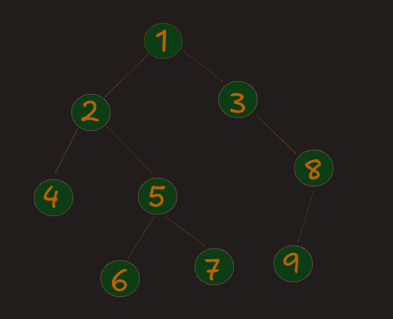
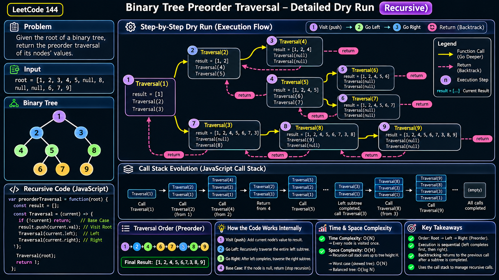

# 144. Binary Tree Preorder Traversal — Answer

**Platform:** LeetCode  
**Difficulty:** Easy  
**Topics:** Binary Tree, DFS, Recursion, Stack  
**Approach:** Recursive Depth First Search (DFS)  
**Time Complexity:** O(N)  
**Auxiliary Space Complexity:** O(H)

---

# 1. Example Input

We will use the following input to understand how our recursive solution works.

**Input:**

```javascript
root = [1, 2, 3, 4, 5, null, 8, null, null, 6, 7, 9]
```

This array represents the following binary tree:




Our task is to return the preorder traversal of this tree.

## Expected Output

```javascript
[1, 2, 4, 5, 6, 7, 3, 8, 9]
```

## Preorder Traversal Rule

```text
ROOT → LEFT → RIGHT
```

This means:

1. Visit the current node first.
2. Complete its entire left subtree.
3. After completing the left subtree, traverse its right subtree.

---

# 2. Dry Run — Step-by-Step Execution





Before looking at the code, let's understand how the function moves through the tree.

Initially, we have:

```javascript
let stack = [];
```

Our result array is empty.

```text
stack = []
```

We start the recursive function:

```javascript
Traversal(root);
```

Since the root contains `1`, execution starts from node `1`.

## Step 1: Visit Node 1 (Root)


The function receives node `1`.

```javascript
Traversal(1);
```

First, JavaScript checks:

```javascript
if (!Current) return;
```


`Current` contains node `1`, so it is not null. The function continues.

Next:

```javascript
stack.push(Current.val);
```

We add `1` to the result.


Now JavaScript executes:

```javascript
Traversal(Current.left);
```

The left child of node `1` is `2`.

Therefore:

```javascript
Traversal(2);
```

**Important:** The function call for node `1` pauses here. It does not execute the right recursive call yet.

It waits until the entire left subtree is completed.


## Step 2: Visit Node 2


Now a new recursive function call starts.

```javascript
Traversal(2);
```

Node `2` is not null.

We push its value:

```javascript
stack.push(2);
```

Result:

```text
stack = [1, 2]
```

Next:

```javascript
Traversal(Current.left);
```

The left child of node `2` is `4`.

Therefore:

```javascript
Traversal(4);
```

The function call for node `2` pauses.

## Step 3: Visit Node 4


JavaScript starts executing:

```javascript
Traversal(4);
```

Node `4` is not null.

We push its value:

```javascript
stack.push(4);
```

Result:

```text
stack = [1, 2, 4]
```

Now execute:

```javascript
Traversal(Current.left);
```

Node `4` has no left child.

Therefore:

```javascript
Traversal(null);
```

## Step 4: Reach Null — First Return


JavaScript starts another function call:

```javascript
Traversal(null);
```

Now the condition executes:

```javascript
if (!Current) return;
```

Because `Current` is null, the condition is true.

The function immediately returns.

**Where does JavaScript return?**

It returns to the previous paused function call:

```javascript
Traversal(4);
```

Remember, node `4` was paused at:

```javascript
Traversal(Current.left);
```

That recursive call has now completed.

JavaScript moves to the next statement:

```javascript
Traversal(Current.right);
```

Node `4` also has no right child.

Therefore:

```javascript
Traversal(null);
```

The base condition executes again, and this function returns.

Now both children of node `4` have been completed.

The function for node `4` finishes.


## Step 5: Return to Node 2


After completing node `4`, JavaScript returns to the paused function:

```javascript
Traversal(2);
```

Now look at the original code:

```javascript
Traversal(Current.left);
Traversal(Current.right);
```

The first statement has already completed.

Therefore, JavaScript executes the second statement:

```javascript
Traversal(Current.right);
```

The right child of node `2` is `5`.

So:

```javascript
Traversal(5);
```

Notice that node `5` is visited only after the entire left subtree of node `2` has finished.

## Step 6: Visit Node 5


Node `5` is not null.

We push its value:

```javascript
stack.push(5);
```

Result:

```text
stack = [1, 2, 4, 5]
```

Now execute:

```javascript
Traversal(Current.left);
```

The left child of node `5` is `6`.

Therefore:

```javascript
Traversal(6);
```

## Step 7: Visit Node 6

We push `6`.

```text
stack = [1, 2, 4, 5, 6]
```

Now execute:

```javascript
Traversal(Current.left);
```

The left child is null.

The function returns.

Next:

```javascript
Traversal(Current.right);
```

The right child is also null.

The function returns again.

Both children of node `6` are completed.

Therefore, the function for node `6` finishes.

## Step 8: Return to Node 5

JavaScript returns to the paused function:

```javascript
Traversal(5);
```

Its left subtree has completed.

Now JavaScript executes:

```javascript
Traversal(Current.right);
```

The right child of node `5` is `7`.

Therefore:

```javascript
Traversal(7);
```

## Step 9: Visit Node 7

We push `7`.

```text
stack = [1, 2, 4, 5, 6, 7]
```

Node `7` has no left or right child.

Both recursive calls receive null and return.

The function for node `7` finishes.

Now node `5` also finishes because both its left and right subtrees are completed.

## Step 10: Return to Node 2

At this point, node `2` has completed:

```text
       2
      / \
     4   5
        / \
       6   7
```

Its entire left subtree and right subtree are completed.

The function for node `2` finishes.

JavaScript returns to the original function call for node `1`.

## Step 11: Return to Node 1

Remember, node `1` was originally paused at:

```javascript
Traversal(Current.left);
```

The entire left subtree is now completed.

Therefore, JavaScript executes:

```javascript
Traversal(Current.right);
```

The right child of node `1` is `3`.

So:

```javascript
Traversal(3);
```

Current result:

```text
stack = [1, 2, 4, 5, 6, 7]
```

## Step 12: Visit Node 3

Push `3`.

```text
stack = [1, 2, 4, 5, 6, 7, 3]
```

Now execute:

```javascript
Traversal(Current.left);
```

The left child of node `3` is null.

The function returns.

Next:

```javascript
Traversal(Current.right);
```

The right child of node `3` is `8`.

Therefore:

```javascript
Traversal(8);
```

## Step 13: Visit Node 8

Push `8`.

```text
stack = [1, 2, 4, 5, 6, 7, 3, 8]
```

Now execute:

```javascript
Traversal(Current.left);
```

The left child of node `8` is `9`.

Therefore:

```javascript
Traversal(9);
```

## Step 14: Visit Node 9

Push `9`.

```text
stack = [1, 2, 4, 5, 6, 7, 3, 8, 9]
```

Node `9` has no left or right children.

Both recursive calls receive null and return.

The function for node `9` finishes.

JavaScript returns to node `8`.

Node `8` then executes its right recursive call. Its right child is null, so that call returns.

Node `8` finishes.

JavaScript returns to node `3`.

Node `3` finishes because both its left and right subtrees are completed.

Finally, the original function call for node `1` finishes.

All recursive calls are now completed.

**Final Result:**

```javascript
[1, 2, 4, 5, 6, 7, 3, 8, 9]
```

---

# 3. Complete Dry Run Table

The following table summarizes the important operations.

| Step | Current Node | Operation | Result |
|---:|---|---|---|
| 1 | 1 | Visit root | `[1]` |
| 2 | 2 | Visit left of 1 | `[1,2]` |
| 3 | 4 | Visit left of 2 | `[1,2,4]` |
| 4 | null | Return | `[1,2,4]` |
| 5 | null | Return | `[1,2,4]` |
| 6 | 5 | Visit right of 2 | `[1,2,4,5]` |
| 7 | 6 | Visit left of 5 | `[1,2,4,5,6]` |
| 8 | null | Return | `[1,2,4,5,6]` |
| 9 | null | Return | `[1,2,4,5,6]` |
| 10 | 7 | Visit right of 5 | `[1,2,4,5,6,7]` |
| 11 | null | Return | `[1,2,4,5,6,7]` |
| 12 | null | Return | `[1,2,4,5,6,7]` |
| 13 | 3 | Visit right of 1 | `[1,2,4,5,6,7,3]` |
| 14 | null | Return | No change |
| 15 | 8 | Visit right of 3 | `[1,2,4,5,6,7,3,8]` |
| 16 | 9 | Visit left of 8 | `[1,2,4,5,6,7,3,8,9]` |
| 17 | null | Return | No change |
| 18 | null | Return | No change |
| 19 | null | Return | No change |

---

# 4. JavaScript Solution

Now let's look at the complete implementation.

```javascript
/**
 * Definition for a binary tree node.
 * function TreeNode(val, left, right) {
 *     this.val = (val === undefined ? 0 : val);
 *     this.left = (left === undefined ? null : left);
 *     this.right = (right === undefined ? null : right);
 * }
 */

/**
 * @param {TreeNode} root
 * @return {number[]}
 */
var preorderTraversal = function(root) {

    let stack = [];

    let Traversal = (Current) => {

        // Base Case
        if (!Current) return;

        // Visit Root
        stack.push(Current.val);

        // Traverse Left Subtree
        Traversal(Current.left);

        // Traverse Right Subtree
        Traversal(Current.right);
    };

    Traversal(root);

    return stack;
};
```

---

# 5. How Does This Code Work Internally?

This is the most important part of understanding recursion.

Let's understand what JavaScript actually does when a function calls itself.

## 5.1 Function Calls Are Not Executed Simultaneously

Consider:

```javascript
let Traversal = (Current) => {

    if (!Current) return;

    stack.push(Current.val);

    Traversal(Current.left);

    Traversal(Current.right);
};
```

JavaScript executes these statements sequentially.

It does not execute the left and right recursive calls together.

For example, when the current node is `1`:

```javascript
Traversal(Current.left);
```

The left child is `2`.

JavaScript starts executing:

```javascript
Traversal(2);
```

The original function call for node `1` pauses.

It cannot execute:

```javascript
Traversal(Current.right);
```

until the entire recursive call for the left subtree has finished.

This is because JavaScript is executing synchronous function calls.

## 5.2 What Happens When a Function Calls Itself?

Every time a function is called, JavaScript creates a new execution context.

This execution context keeps track of information such as:

- Function arguments.
- Local variables.
- Current execution position.
- Return information.

JavaScript manages these function calls using the **Call Stack**.

The call stack follows:

```text
LIFO = Last In, First Out
```

The last function called is the first one to finish.

## 5.3 Understanding the Call Stack

Suppose execution has reached node `4`.

The active function calls look conceptually like this:

```text
       TOP
    ┌────────────┐
    │ dfs(4)     │  Currently executing
    ├────────────┤
    │ dfs(2)     │  Waiting for dfs(4)
    ├────────────┤
    │ dfs(1)     │  Waiting for dfs(2)
    └────────────┘
```

When `dfs(4)` finishes:

```text
       TOP
    ┌────────────┐
    │ dfs(2)     │  Resumes execution
    ├────────────┤
    │ dfs(1)     │  Still waiting
    └────────────┘
```

After the entire left subtree of node `1` finishes:

```text
       TOP
    ┌────────────┐
    │ dfs(1)     │  Resumes execution
    └────────────┘
```

Now node `1` can execute its right recursive call.

This is called **returning from a recursive call**.

---

# 6. Understanding the Three Important Statements

Our complete algorithm depends on these three statements.

### 1. Visit the Current Node

```javascript
stack.push(Current.val);
```

This statement adds the current node's value to the result array.

For example:

```javascript
Current = Node(1);
stack.push(Current.val);
```

Result:

```javascript
[1]
```

### 2. Traverse the Left Subtree

```javascript
Traversal(Current.left);
```

This recursively explores the entire left subtree.

It keeps going deeper until it reaches a null node.

Only after the left recursive call finishes does JavaScript continue to the next statement.

### 3. Traverse the Right Subtree

```javascript
Traversal(Current.right);
```

This statement executes after the entire left subtree is completed.

It explores the right subtree in the same way.

**This order is what makes the algorithm preorder traversal.**

---

# 7. Why Do We Need the Base Case?

```javascript
if (!Current) return;
```

The base case is the stopping condition of recursion.

Without it, the function would keep trying to access the children of nodes that do not exist.

Consider:

```text
       1
      /
     2
```

Node `2` has no left child.

When JavaScript executes:

```javascript
Traversal(Current.left);
```

It receives:

```javascript
Traversal(null);
```

The base case detects null and immediately returns.

This prevents errors such as:

```text
Cannot read properties of null
```

**Remember:** Every recursive function needs a clear stopping condition.

---

# 8. Why Does JavaScript Return to the Previous Function?

Consider:

```javascript
Traversal(Current.left);

Traversal(Current.right);
```

Suppose we are currently executing:

```javascript
Traversal(1);
```

Its left child is `2`.

Execution:

```text
Traversal(1)
    |
    | Call left
    v
Traversal(2)
    |
    | Call left
    v
Traversal(4)
    |
    | Left = null
    | Right = null
    v
Traversal(4) finishes
    |
    v
Return to Traversal(2)
    |
    | Execute right
    v
Traversal(5)
```

The important point is that JavaScript remembers where each function call was paused.

When a function returns, execution resumes from the next statement after the completed function call.

This behavior is called **backtracking through recursive calls**.

---

# 9. Time Complexity Analysis

Let `N` represent the total number of nodes in the binary tree.

Our algorithm visits every existing node exactly once.

For each node, we perform:

1. A null check.
2. An array insertion.
3. A recursive call for the left child.
4. A recursive call for the right child.

Therefore:

```text
Time Complexity = O(N)
```

Why?

If the tree contains:

- 1 node → visit 1 node.
- 10 nodes → visit 10 nodes.
- 100 nodes → visit 100 nodes.

The amount of work grows linearly with the number of nodes.

**Final Time Complexity: O(N)**

---

# 10. Space Complexity Analysis

There are two different types of space used by our algorithm.

### A. Result Array

```javascript
let stack = [];
```

We store every node's value in this array.

If the tree contains `N` nodes:

```text
Result Array Space = O(N)
```

### B. Recursive Call Stack

Every recursive function call occupies space in JavaScript's call stack.

The maximum number of simultaneously active recursive calls depends on the height of the tree.

Let `H` be the height of the tree.

```text
Recursive Call Stack = O(H)
```

Consider two cases.

**Case 1: Balanced Binary Tree**

```text
          1
        /   \
       2     3
      / \   / \
     4   5 6   7
```

The tree height is approximately `log N`.

Therefore:

```text
Call Stack Space = O(log N)
```

**Case 2: Skewed Binary Tree**

```text
       1
        \
         2
          \
           3
            \
             4
              \
               5
```

The tree height is approximately `N`.

Therefore:

```text
Call Stack Space = O(N)
```

### Final Space Complexity

| Space | Complexity |
|---|---|
| Result array | O(N) |
| Recursive call stack | O(H) |
| Auxiliary space (excluding output) | O(H) |
| Total space including output | O(N + H) |

Since `H <= N`, total space is O(N).

**Important interview distinction:** When LeetCode solutions report auxiliary space complexity, they generally exclude the returned result array. Therefore, the recursive solution has O(H) auxiliary space, with O(N) worst-case auxiliary space.

---

# 11. Why Is This DFS?

DFS stands for **Depth First Search**.

It means exploring one branch as deeply as possible before moving to another branch.

Consider:

```text
       1
      / \
     2   3
    / \
   4   5
```

DFS preorder execution:

```text
1 → 2 → 4 → 5 → 3
```

Notice that we completely explore the left subtree before moving to the right subtree.

That is exactly what our recursive implementation does.

---

# 12. Common Mistakes

### Mistake 1: Wrong Traversal Order

Incorrect:

```javascript
Traversal(Current.left);
stack.push(Current.val);
Traversal(Current.right);
```

This follows:

```text
LEFT → ROOT → RIGHT
```

That is inorder traversal, not preorder.

Correct:

```javascript
stack.push(Current.val);
Traversal(Current.left);
Traversal(Current.right);
```

### Mistake 2: Forgetting the Base Case

Incorrect:

```javascript
let Traversal = (Current) => {
    stack.push(Current.val);
    Traversal(Current.left);
    Traversal(Current.right);
};
```

This causes an error when `Current` is null.

Correct:

```javascript
if (!Current) return;
```

### Mistake 3: Traversing Right Before Left

Incorrect:

```javascript
stack.push(Current.val);
Traversal(Current.right);
Traversal(Current.left);
```

This visits the right subtree before the left subtree.

It does not follow preorder.

### Mistake 4: Confusing the Result Array with the Call Stack

In our implementation:

```javascript
let stack = [];
```

This variable is actually an array used to store traversal results.

It is not JavaScript's internal call stack.

A clearer variable name would be:

```javascript
let result = [];
```

---

# 13. Improved Code (Recommended)

The following implementation uses clearer variable names.

```javascript
var preorderTraversal = function(root) {

    const result = [];

    function dfs(node) {

        // Base Case
        if (node === null) return;

        // Root
        result.push(node.val);

        // Left
        dfs(node.left);

        // Right
        dfs(node.right);
    }

    dfs(root);

    return result;
};
```

The logic is exactly the same.

The only difference is that we use:

- `result` instead of `stack`.
- `dfs` instead of `Traversal`.
- `node` instead of `Current`.
- `node === null` for an explicit null check.

This makes the implementation easier to read and understand.

---

# 14. Interview Questions and Answers

**Q1. What is preorder traversal?**

Preorder traversal is a depth-first tree traversal technique that visits the root first, then the left subtree, and finally the right subtree.

**Q2. Why do we use recursion?**

Recursion allows us to solve the problem by applying the same traversal logic to smaller subtrees.

**Q3. What is the base case?**

```javascript
if (node === null) return;
```

It stops recursive calls when a missing child is reached.

**Q4. Does the right recursive call execute immediately after the left recursive call starts?**

No. The left recursive call must finish completely before JavaScript executes the right recursive call.

**Q5. What happens when a recursive function completes?**

JavaScript removes its execution context from the call stack and resumes the previous function call from where it was paused.

**Q6. What is backtracking in recursion?**

Backtracking means returning to a previous function call after completing a recursive call, allowing execution to continue with the remaining statements.

**Q7. What is the time complexity?**

O(N), because every node is visited exactly once.

**Q8. What is the auxiliary space complexity?**

O(H), where H is the height of the tree. In the worst case, it becomes O(N).

**Q9. Can preorder traversal be implemented without recursion?**

Yes. We can use an explicit stack to implement iterative DFS.

**Q10. What is the difference between the JavaScript call stack and our result array?**

The call stack manages function execution. The result array stores the visited node values.

---

# 15. Final Revision Notes

| Concept | Remember |
|---|---|
| Algorithm | DFS |
| Technique | Recursion |
| Traversal | Preorder |
| Order | Root → Left → Right |
| Base Case | `if (node === null) return` |
| Visit Node | `result.push(node.val)` |
| Left Call | `dfs(node.left)` |
| Right Call | `dfs(node.right)` |
| Time Complexity | O(N) |
| Auxiliary Space | O(H) |
| Worst-case Auxiliary Space | O(N) |
| Total Space | O(N) |

## Final Output

```javascript
[1, 2, 4, 5, 6, 7, 3, 8, 9]
```

## Most Important Things to Remember

1. Recursion means a function calls itself.
2. Every recursive call has its own execution context.
3. JavaScript uses the call stack to manage recursive calls.
4. The current function pauses when another function is called.
5. The left subtree must finish before the right subtree starts.
6. The base case stops recursion.
7. After a recursive call finishes, execution returns to the previous function.
8. Preorder always follows Root → Left → Right.

**One-line summary:** Visit the current node, completely traverse its left subtree, then completely traverse its right subtree.