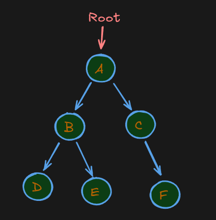
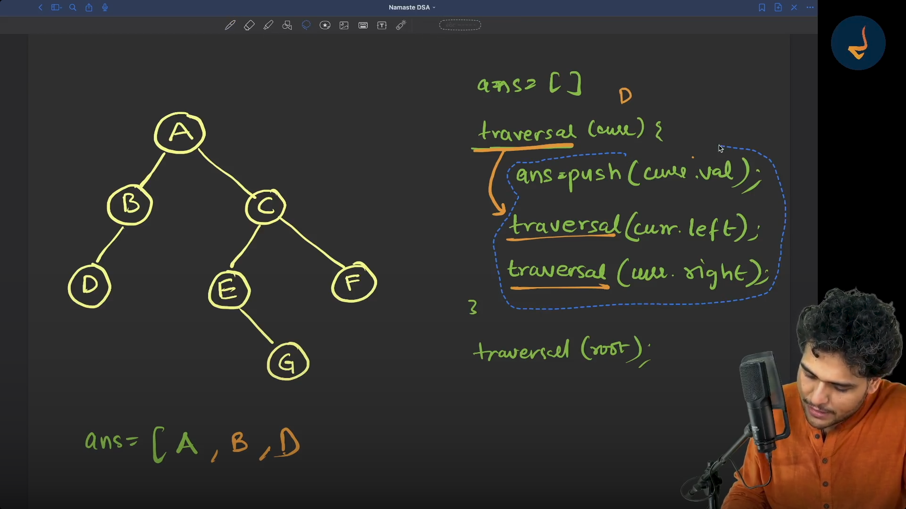
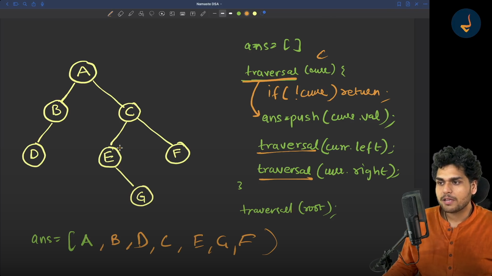

# Chapter 4 — Traversal in Data Structures

> **Goal:** Understand traversal as a general DSA concept—not only binary-tree traversal. These notes cover arrays, strings, linked lists, trees, graphs, and common traversal techniques.

## 1. What Is Traversal?

**Traversal** means visiting elements or nodes of a data structure in a systematic order so we can read, search, print, update, or process them.

In simple words:

> **Traversal = Visit the elements one by one according to a rule.**

Examples:
- Array: visit each element from left to right.
- Linked list: follow each node's `next` pointer.
- Tree: visit nodes by depth-first or breadth-first rules.
- Graph: explore vertices while avoiding repeated visits.

### Why do we use traversal?

Traversal helps us:
- Print or read data.
- Search for a value.
- Calculate a sum, count, minimum, or maximum.
- Update or validate elements.
- Process hierarchical data such as folders or organization charts.
- Explore connected locations in a graph.

**Important:** Traversal describes the order in which we visit elements. Searching describes the goal of finding a target. A search algorithm may use traversal, but it can stop when the target is found.

---

## 2. Traversal Across Data Structures

Different data structures connect their elements differently, so their traversal rules differ.

| Data structure | How we move | Common traversal |
|---|---|---|
| Array | By index | Forward, backward |
| String | By character index | Left to right, right to left |
| Linked list | Through `next` (and sometimes `prev`) | Head to tail, tail to head where supported |
| Tree | Through parent-child links | DFS, BFS |
| Graph | Through edges | DFS, BFS |
| Matrix / grid | Through row and column positions | Row-wise, column-wise, or graph-style exploration |

### 2.1 Array traversal

```text
Array: [10, 20, 30, 40, 50]
Index:   0   1   2   3   4
```

Forward traversal:

```text
10 → 20 → 30 → 40 → 50
```

Backward traversal:

```text
50 → 40 → 30 → 20 → 10
```

JavaScript:

```js
const values = [10, 20, 30, 40, 50];

// Forward traversal
for (let i = 0; i < values.length; i++) {
  console.log(values[i]);
}

// Backward traversal
for (let i = values.length - 1; i >= 0; i--) {
  console.log(values[i]);
}
```

**Complexity:** Visiting all `n` elements takes `O(n)` time. The loop uses `O(1)` extra space.

### 2.2 String traversal

A string can be traversed character by character.

```js
const word = "TREE";

for (let i = 0; i < word.length; i++) {
  console.log(word[i]);
}
```

Output:

```text
T
R
E
E
```

For many basic DSA problems, indexed traversal is enough. Remember that JavaScript string indexing works with UTF-16 code units, so some Unicode characters may require different handling.

### 2.3 Linked-list traversal

A linked list does not provide direct index access like an array. Start at the head and follow each node's `next` pointer.

```text
head
 ↓
10 → 20 → 30 → 40 → null
```

Language-independent pseudocode:

```text
current = head

WHILE current is not null:
    PROCESS current.value
    current = current.next
```

JavaScript:

```js
function traverse(head) {
  let current = head;

  while (current !== null) {
    console.log(current.value);
    current = current.next;
  }
}
```

**Common mistake:** Forgetting `current = current.next` causes an infinite loop when `current` is not `null`.

**Complexity:** `O(n)` time and `O(1)` extra space for this iterative approach.

---

## 3. Traversal in Trees

A **tree** is a hierarchical, non-linear data structure made of nodes connected by parent-child relationships.

Example:




Important terms:

- **Root:** The top node (`A`).
- **Parent:** A node that has children (`B` is the parent of `D` and `E`).
- **Child:** A node directly below another node.
- **Leaf:** A node with no children (`D`, `E`, and `F`).
- **Subtree:** A node together with its descendants.
- **Depth:** Number of edges from the root to a node.
- **Height:** Number of edges on the longest downward path from a node to a leaf. Some definitions count nodes instead, so state the convention when needed.

Trees have branches, so we need a rule to decide which node to visit next.

---

## 4. The Two Main Tree-Traversal Families

```text
Tree Traversal
├── DFS — Depth-First Search
│   ├── Preorder
│   ├── Inorder (binary trees)
│   └── Postorder
└── BFS — Breadth-First Search
    └── Level-order traversal
```

- **DFS:** Explore one branch deeply before moving to another branch.
- **BFS:** Visit nodes level by level, usually using a queue.

The terms Preorder, Inorder, and Postorder describe when the current node is processed relative to its children. Inorder specifically assumes a binary-tree structure with a left and right child position.

---

# 5. Depth-First Search (DFS) in a Tree

## 5.1 What is DFS?

**DFS** stands for **Depth-First Search**. It is a way to visit every node in a tree.

DFS starts at a node and follows one branch **as deep as it can**. When it reaches the end of that branch, it **goes back** to the last place where it could take another branch. This is called **backtracking**.

Think of exploring a maze:

1. Choose a path.
2. Keep going until you reach a dead end.
3. Go back to the last junction.
4. Try another path.

## 5.2 Example tree

We’ll use this tree for all three DFS orders:


- **A** is the root.
- **B** and **C** are children of A.
- **D** and **E** are children of B.
- **F** and **G** are children of C.
- **D, E, F, G** are leaf nodes: they have no children.

Assume we visit children from **left to right**.

## 5.3. The three common DFS orders

DFS has three common ways to decide **when to process a node**:

| Traversal | Rule | When is the parent processed? |
|---|---|---|
| Preorder | Node → Left → Right | Before its children |
| Inorder | Left → Node → Right | Between its children |
| Postorder | Left → Right → Node | After its children |

Here, **process** means “visit or record the node.” For example, if we print the nodes, processing a node means printing its value.

---

## 5.4. Preorder: Node → Left → Right





In **preorder**, visit the current node **first**, then explore its children from left to right.

For a binary tree:

```text
ROOT → LEFT → RIGHT
```

### Walkthrough


1. Visit **A**.
2. Go left to **B** and visit it.
3. Go left to **D** and visit it. D has no children, so go back.
4. Visit B’s right child, **E**.
5. Go back to A and visit its right child, **C**.
6. Visit C’s left child, **F**.
7. Visit C’s right child, **G**.

**Preorder result:**


```text
A → B → D → E → C → F → G
```

**Memory tip:** **Pre**order means the parent is processed **before** its children.

**Common uses:**

- Printing a hierarchy from the top down
- Copying or saving a tree
- Producing prefix notation from an expression tree

---

## 5.5. Inorder: Left → Node → Right

In **inorder**, explore the left side first, visit the current node, then explore the right side.

For a binary tree:

```text
LEFT → ROOT → RIGHT
```

### Walkthrough

1. Start at A and go left to **B**.
2. Go left again to **D**. D has no left child, so visit D.
3. Return to B and visit **B**.
4. Visit B’s right child, **E**.
5. Return to A and visit **A**.
6. Go right to **C**. Visit its left child, **F**.
7. Visit **C**, then its right child, **G**.

**Inorder result:**

```text
D → B → E → A → F → C → G
```

**Memory tip:** The parent is processed **in between** its left and right subtrees.

### Important: Inorder is for binary trees

Inorder is naturally defined for a **binary tree**, where each node has at most two children: a left child and a right child.

A general tree may have any number of children, so there is no single standard inorder rule for it.

### Special use: Binary Search Trees

For a **Binary Search Tree (BST)**, inorder traversal produces the values in sorted order.

For example, if the tree follows BST ordering rules:

```text
Inorder result: smallest value → ... → largest value
```

This works because smaller values are placed to the left and larger values to the right.

---

## 5.6. Postorder: Left → Right → Node

In **postorder**, visit all of a node’s children first, then visit the node itself.

For a binary tree:

```text
LEFT → RIGHT → ROOT
```

### Walkthrough

1. Start at A and go left to **B**.
2. Visit B’s left child, **D**.
3. Visit B’s right child, **E**.
4. Now visit **B**.
5. Return to A and go right to **C**.
6. Visit C’s left child, **F**.
7. Visit C’s right child, **G**.
8. Now visit **C**.
9. Finally, visit **A**.

**Postorder result:**

```text
D → E → B → F → G → C → A
```

**Memory tip:** **Post**order means the parent is processed **after** its children.

**Common uses:**

- Deleting a tree from the leaves upward
- Calculating the size of folders from their contents
- Evaluating expression trees in postfix form
- Processing child results before calculating a parent’s result

---

## 5.7. Comparing the three results

Using the same tree:

```text
          A
        /   \
       B     C
      / \   / \
     D   E F   G
```

| Order | Result |
|---|---|
| **Preorder** | A → B → D → E → C → F → G |
| **Inorder** | D → B → E → A → F → C → G |
| **Postorder** | D → E → B → F → G → C → A |

The tree does not change. Only **when each parent is visited** changes:

- **Preorder:** visit parent first
- **Inorder:** visit parent between left and right
- **Postorder:** visit parent last

---

## 5.8. DFS on a general tree

A **general tree** can have any number of children. For preorder and postorder, visit the children from left to right.

Example:

```text
          A
        / | \
       B  C  D
      / \
     E   F
```

**Preorder:** visit each node before its children.

```text
A → B → E → F → C → D
```

**Postorder:** visit each node after its children.

```text
E → F → B → C → D → A
```

There is no single standard inorder traversal for this general tree.

---

## 5.9. How DFS is implemented

DFS is commonly implemented using either **recursion** or an explicit **stack**.

### Recursion

A recursive traversal calls the same function on each child. When a child has no more descendants, the function returns to the parent. That return is the backtracking step.

Preorder example for a binary tree:

```text
preorder(node):
    if node is empty:
        return

    visit(node)
    preorder(node.left)
    preorder(node.right)
```

To get the other orders, move `visit(node)`:

```text
inorder(node):
    if node is empty:
        return

    inorder(node.left)
    visit(node)
    inorder(node.right)
```

```text
postorder(node):
    if node is empty:
        return

    postorder(node.left)
    postorder(node.right)
    visit(node)
```

### Stack

A **stack** stores nodes to visit later. It follows **last in, first out**: the most recently added node is taken out first. This helps DFS go deep down a branch before returning to other branches.

Recursion uses the computer’s call stack automatically.

---

## 10. A simple way to remember everything

Look at where the word **Node** appears:

```text
Preorder:  Node → Left → Right
Inorder:   Left → Node → Right
Postorder: Left → Right → Node
```

Or remember:

- **Preorder:** parent **first**
- **Inorder:** parent **in the middle**
- **Postorder:** parent **last**

##  Key points

- DFS explores a branch deeply before moving to another branch.
- When a path ends, DFS goes back using **backtracking**.
- **Preorder, inorder, and postorder** differ in when they visit the parent.
- Inorder is mainly used with **binary trees**.
- DFS can be implemented with **recursion** or a **stack**.


## 6. Recursive DFS Pattern

A tree is recursive in structure: each child can itself be the root of a smaller subtree.

### Preorder pseudocode

```text
PREORDER(node):
    IF node is null:
        RETURN

    PROCESS node
    PREORDER(node.left)
    PREORDER(node.right)
```

### Inorder pseudocode (binary tree)

```text
INORDER(node):
    IF node is null:
        RETURN

    INORDER(node.left)
    PROCESS node
    INORDER(node.right)
```

### Postorder pseudocode

```text
POSTORDER(node):
    IF node is null:
        RETURN

    POSTORDER(node.left)
    POSTORDER(node.right)
    PROCESS node
```

The **base case** (`node is null`) stops recursion when there is no node to process.

### JavaScript example

Assume each binary-tree node has `value`, `left`, and `right` properties.

```js
function preorder(node) {
  if (node === null) return;

  console.log(node.value);
  preorder(node.left);
  preorder(node.right);
}

function inorder(node) {
  if (node === null) return;

  inorder(node.left);
  console.log(node.value);
  inorder(node.right);
}

function postorder(node) {
  if (node === null) return;

  postorder(node.left);
  postorder(node.right);
  console.log(node.value);
}
```

The functions differ only in the position of `console.log(node.value)`. That is the core idea.

---

## 7. Understanding the Call Stack During DFS

Consider this tree:

```text
    A
   /
  B
 /
C
```

When calling `preorder(A)`:

1. `preorder(A)` processes `A`, then calls `preorder(B)`.
2. `preorder(B)` processes `B`, then calls `preorder(C)`.
3. `preorder(C)` processes `C`, then calls traversal on its missing left child.
4. The null call returns immediately.
5. The remaining calls return one by one.

Conceptually:

```text
Call preorder(A)
  Call preorder(B)
    Call preorder(C)
      Call preorder(null) → return
      Call preorder(null) → return
    Return from C
    Call preorder(null) → return
  Return from B
  Call preorder(null) → return
Return from A
```

The call stack remembers where each function must continue after a child traversal finishes. This is why recursive DFS naturally supports backtracking.

---

## 8. Breadth-First Search (BFS) / Level-Order Traversal

BFS visits nodes one level at a time, from top to bottom. Within each level, this example visits left to right.

```text
          A
        /   \
       B     C
      / \     \
     D   E     F
```

Level-order output:

```text
A → B → C → D → E → F
```

### Why does BFS use a queue?

A queue follows **FIFO**: First In, First Out.

1. Add the root to the queue.
2. Remove the front node and process it.
3. Add its children to the back of the queue.
4. Repeat until the queue is empty.

### Pseudocode

```text
LEVEL_ORDER(root):
    IF root is null:
        RETURN

    CREATE empty queue
    ENQUEUE root

    WHILE queue is not empty:
        node = DEQUEUE queue
        PROCESS node

        IF node.left exists:
            ENQUEUE node.left

        IF node.right exists:
            ENQUEUE node.right
```

### JavaScript implementation

```js
function levelOrder(root) {
  if (root === null) return [];

  const result = [];
  const queue = [root];
  let front = 0;

  while (front < queue.length) {
    const node = queue[front];
    front++;

    result.push(node.value);

    if (node.left !== null) queue.push(node.left);
    if (node.right !== null) queue.push(node.right);
  }

  return result;
}
```

Using a `front` index avoids repeatedly removing the first array element with `shift()`, which can be inefficient in JavaScript.

**Common uses:** Level-by-level display, shortest paths in unweighted graphs, and finding the minimum number of edges from a starting vertex.

---

## 9. Iterative DFS Using a Stack

DFS does not have to use recursion. We can manage the work explicitly with a **stack**.

A stack follows **LIFO**: Last In, First Out.

For binary-tree preorder, push the right child before the left child. The left child is then popped first.

```js
function preorderIterative(root) {
  if (root === null) return [];

  const result = [];
  const stack = [root];

  while (stack.length > 0) {
    const node = stack.pop();
    result.push(node.value);

    // Push right first so left is processed first.
    if (node.right !== null) stack.push(node.right);
    if (node.left !== null) stack.push(node.left);
  }

  return result;
}
```

**Key idea:** A stack is the iterative tool commonly used for DFS; a queue is the standard tool for BFS.

---

## 10. Traversal in General Trees (N-ary Trees)

A **general tree** may allow any number of children per node. An **N-ary tree** is a tree where each node can have up to `N` children.

Example:

```text
          A
       /  |  \
      B   C   D
     / \      |
    E   F     G
```

Possible preorder (parent first, children left to right):

```text
A → B → E → F → C → D → G
```

Possible postorder (children first, parent last):

```text
E → F → B → C → G → D → A
```

Level-order:

```text
A → B → C → D → E → F → G
```

There is no single standard inorder rule for a general tree because there may be more than two children.

### General-tree pseudocode

```text
PREORDER(node):
    IF node is null:
        RETURN

    PROCESS node

    FOR each child of node, from left to right:
        PREORDER(child)
```

```text
POSTORDER(node):
    IF node is null:
        RETURN

    FOR each child of node, from left to right:
        POSTORDER(child)

    PROCESS node
```

These patterns apply to structures such as organization charts, folder hierarchies, and nested UI menus.

---

## 11. Graph Traversal: DFS and BFS

A **graph** consists of vertices (nodes) connected by edges. Unlike a tree, a graph may contain cycles, and a node may be reachable through multiple paths.

Example:

```text
A ─── B
|     |
C ─── D
```

Because edges can lead back to already visited vertices, graph traversal needs a **visited set** (or visited array). Without it, a traversal can loop forever on a cycle.

### 11.1 Graph DFS

DFS explores one path deeply before returning.

```text
DFS(start):
    CREATE empty visited set
    CREATE stack containing start

    WHILE stack is not empty:
        node = POP stack

        IF node is already visited:
            CONTINUE

        MARK node visited
        PROCESS node

        PUSH unvisited neighbours onto stack
```

Recursive DFS is also common:

```text
DFS(node):
    MARK node visited
    PROCESS node

    FOR each neighbour of node:
        IF neighbour is not visited:
            DFS(neighbour)
```

In recursive code, mark a node as visited **before** recursively exploring its neighbours.

### 11.2 Graph BFS

BFS explores all immediate neighbours before moving farther away.

```text
BFS(start):
    CREATE empty visited set
    CREATE empty queue

    MARK start visited
    ENQUEUE start

    WHILE queue is not empty:
        node = DEQUEUE queue
        PROCESS node

        FOR each neighbour of node:
            IF neighbour is not visited:
                MARK neighbour visited
                ENQUEUE neighbour
```

Marking a neighbour visited when it is enqueued prevents it from being added to the queue repeatedly.

### Important graph notes

- Traversal order depends on the order in which neighbours are stored or considered.
- A disconnected graph may have vertices that cannot be reached from one starting node. To traverse every component, start another DFS/BFS from each still-unvisited vertex.
- With an adjacency-list representation, DFS and BFS typically take `O(V + E)` time, where `V` is the number of vertices and `E` is the number of edges.

---

## 12. Traversal in a Matrix or Grid

A matrix can be traversed row by row, column by column, or treated as a graph.

Example:

```text
1  2  3
4  5  6
7  8  9
```

### Row-wise traversal

```text
1 → 2 → 3 → 4 → 5 → 6 → 7 → 8 → 9
```

```js
function traverseRows(matrix) {
  for (let row = 0; row < matrix.length; row++) {
    for (let col = 0; col < matrix[row].length; col++) {
      console.log(matrix[row][col]);
    }
  }
}
```

### Grid traversal as graph search

Problems involving islands, mazes, connected cells, and shortest paths often treat each cell as a vertex. Neighbouring cells are connected according to the allowed directions (for example, up, down, left, and right).

For DFS/BFS on a grid:
1. Check that a cell is inside the grid.
2. Check whether it is allowed to be visited.
3. Check whether it has already been visited.
4. Mark it visited before exploring further.

---

## 13. Traversal vs Searching

| Traversal | Searching |
|---|---|
| Defines how elements are visited | Defines the goal of finding a target |
| May visit every element | May stop once the target is found |
| Useful for processing all data | Useful for locating specific data |
| Examples: preorder, BFS | Examples: linear search, binary search; graph search may use DFS/BFS |

**Example:** A preorder traversal prints every tree node. A search for value `E` can use preorder but stop once `E` is found.

---

## 14. Common Applications

| Traversal | Typical use |
|---|---|
| Array/string traversal | Counting, filtering, reversing, finding values |
| Linked-list traversal | Printing nodes, searching, calculating length |
| Tree preorder | Parent-first processing, serialization, prefix expressions |
| Tree inorder | Producing sorted values from a BST |
| Tree postorder | Deleting trees, child-first calculations, postfix expressions |
| Tree level-order / BFS | Level-by-level display, minimum-depth problems |
| Graph DFS | Connected components, cycle-related exploration, path exploration |
| Graph BFS | Shortest path by number of edges in an unweighted graph |
| Grid DFS/BFS | Islands, mazes, connected regions |

Applications depend on the data structure and the problem's requirements; no traversal is best for every situation.

---

## 15. Time and Space Complexity

Let:
- `n` = number of elements or tree nodes.
- `V` = number of graph vertices.
- `E` = number of graph edges.
- `h` = height of a tree.

| Traversal | Time | Extra space (typical) |
|---|---:|---:|
| Array/string full traversal | `O(n)` | `O(1)` for a simple loop |
| Singly linked-list traversal | `O(n)` | `O(1)` iterative |
| Recursive binary-tree DFS | `O(n)` | `O(h)` call stack |
| Binary-tree BFS | `O(n)` | `O(w)` queue, where `w` is maximum width |
| Graph DFS with adjacency lists | `O(V + E)` | `O(V)` for visited state and stack/recursion |
| Graph BFS with adjacency lists | `O(V + E)` | `O(V)` for visited state and queue |
| Matrix row-wise traversal | `O(rows × columns)` | `O(1)` extra for the loops |

For recursive tree DFS:
- A balanced tree usually has height `O(log n)`.
- A highly skewed tree can have height `O(n)`.
- Therefore, recursive call-stack space is `O(h)`, not always `O(log n)`.

For tree BFS, `w` is the maximum number of nodes held at one level, so worst-case auxiliary space can be `O(n)`.

---

## 16. Common Mistakes

1. **Confusing traversal with searching.** Traversal is the visiting order; searching is the task of finding a target.
2. **Forgetting the base case in recursion.** Stop when the node is `null` (or absent).
3. **Mixing up the DFS orders.**
   - Preorder: Node, Left, Right.
   - Inorder: Left, Node, Right.
   - Postorder: Left, Right, Node.
4. **Calling inorder a universal tree traversal.** Its usual definition depends on binary trees.
5. **Using a queue for DFS or a stack for ordinary BFS by accident.** The standard choices are stack for iterative DFS and queue for BFS.
6. **Forgetting `visited` in graph traversal.** Cycles can cause repeated work or infinite recursion.
7. **Marking graph vertices too late.** In BFS, mark a vertex visited when enqueuing it.
8. **Assuming traversal order is always unique.** Graph order can change with neighbour ordering.
9. **Using `shift()` repeatedly for a JavaScript queue.** A front index is often a better choice for a simple array-backed queue.
10. **Ignoring recursion depth.** Very deep trees or graphs can exceed the language runtime's call-stack limit.

---

## 17. Quick Comparison: DFS vs BFS

| Feature | DFS | BFS |
|---|---|---|
| Exploration | Goes deep before backtracking | Visits level by level |
| Common structure | Recursion or stack | Queue |
| Tree examples | Preorder, inorder, postorder | Level-order |
| Graph use | Path exploration, components | Shortest path in an unweighted graph |
| Typical memory | Stack/recursion plus visited state | Queue plus visited state |

---

## 18. Interview Questions

### Q1. What is traversal?

Traversal is the systematic process of visiting elements or nodes in a data structure according to a defined order.

### Q2. What is the difference between DFS and BFS?

DFS explores a branch deeply before backtracking. BFS explores neighbouring nodes level by level using a queue.

### Q3. What are preorder, inorder, and postorder?

- Preorder: Node → Left → Right.
- Inorder: Left → Node → Right.
- Postorder: Left → Right → Node.

These named orders are most commonly taught for binary trees.

### Q4. Which traversal gives sorted output for a BST?

Inorder traversal gives ascending order when the tree follows the Binary Search Tree ordering rules.

### Q5. Why does graph traversal need a visited set?

Graphs can contain cycles and multiple paths to the same vertex. A visited set prevents repeated processing and infinite loops.

### Q6. Which data structure is used by BFS?

A queue, because nodes are processed in the order they are discovered.

### Q7. Which data structure is used by iterative DFS?

A stack, because the most recently discovered node is explored next.

### Q8. What is the time complexity of traversing all tree nodes?

`O(n)`, because each node is processed once.

### Q9. What is the time complexity of graph DFS/BFS using adjacency lists?

`O(V + E)`, because vertices and edges are examined a bounded number of times.

### Q10. Can preorder and postorder be used on a general tree?

Yes. Process the parent before its children for preorder, and after its children for postorder. Inorder is not naturally defined for a general tree with an arbitrary number of children.

---

## 19. Final Revision Sheet

```text
TRAVERSAL
= Visit elements systematically.

ARRAY / STRING
= Use indexes.

LINKED LIST
= Follow next pointers.

TREE DFS
Preorder  = Node → Left → Right
Inorder   = Left → Node → Right  (binary tree)
Postorder = Left → Right → Node

TREE BFS
Level order = Visit level by level using a queue.

GRAPH DFS
= Stack or recursion + visited set.

GRAPH BFS
= Queue + visited set.

GRID
= Row/column loops or DFS/BFS through neighbouring cells.

COMPLEXITY
Array/list full traversal       = O(n)
Tree traversal                  = O(n)
Graph DFS/BFS (adjacency list)  = O(V + E)

MEMORY TRICK
Pre = parent before children.
In  = root in between left and right.
Post = parent after children.
BFS = breadth first, level by level.
DFS = depth first, explore deeply then backtrack.
```

## Golden Rule

**First identify the data structure. Then choose the traversal rule that matches the task.**

Do not memorize only the three binary-tree orders. Understand how movement works in arrays, linked lists, trees, graphs, and grids—and why each structure needs its own traversal approach.
